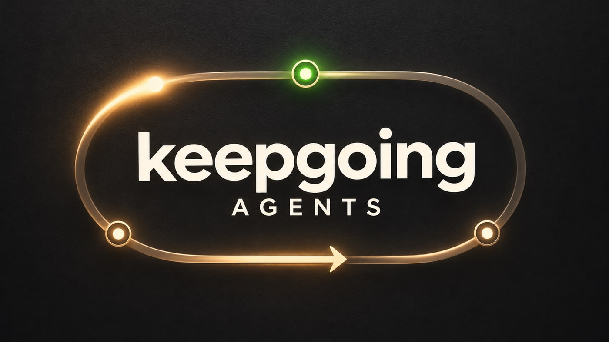

# keepgoing-agents

`keepgoing` supervises a coding agent: it wakes an idle session, handles structured failures with bounded retries, and can hand off to a confirmed fallback when configured. The agent does the work; keepgoing never edits, commits to, or merges a repository.

The core is a single binary for macOS, Linux and Windows. Use its daemon or an existing scheduler to check the loop. No separate loop skill is required. The host and supervisor must be running for checks to happen.

## Current availability

**Latest CLI release: [v0.1.5](https://github.com/connorburgess/keepgoing-agents/releases/tag/v0.1.5); BB plugin: v0.2.0 from the same tag.** Homebrew and downloaded-package evidence is [recorded here](docs/release-verification.md#v015-release-and-package-evidence). Check `keepgoing version` for the installed package. Installing a release does not upgrade a separately deployed supervisor executable or install the BB plugin or macOS companion.

| Surface | What you can use | Verification boundary |
| --- | --- | --- |
| Core CLI | Setup, start, controls, bounds, diagnostics, goals and BB transfer | v0.1.5 includes goal-aware setup; broad offline tests, with partial live BB evidence |
| Headless Claude Code / Codex | New sessions, saved-session resume and configured account environments | Implemented; full live multi-turn, cancellation and separate-account handoff checks remain open |
| BB plugin | Setup, status, controls and transfer for plugin-created loops | Separate installation; newer UI flows are fixture-tested, with live deployment verification open |
| macOS menu preview | Read-only local loop and optional goal display | Developer build only; interactive controls, packaging and accessibility verification remain open |
| Panel page | `keepgoing dock`: a read-only local page for every registered loop, on 127.0.0.1 only | Unreleased; fixtures only. Controls, configuration, a menu-bar or tray item, installation and remote access are planned |
| Cursor CLI | Unreleased primary-only adapter, guided setup and doctor checks | Offline fixtures; one CLI version inspected on macOS, with one live walkthrough of first turn, resume and stop; cannot be a fallback; existing IDE-chat attachment remains open |
| Agents defined in configuration | Unreleased `adapter: custom`: describe another command-line agent by its documented interface ([format](docs/configuration.md#an-agent-defined-in-configuration)) | Offline fixtures with stand-in agents; no real agent has been run from a definition, and guided setup does not create one |
| Antigravity | Internal parser, ACP exchange, saved hold and an unregistered detached runner | Offline fixtures with a stand-in agent; Antigravity itself has never been run. No registered adapter, guided setup or verified existing IDE-chat attachment |

The v0.1.5 changes are **not in v0.1.4**: opt-in goal creation during setup, successful goal-subcommand help exit codes, retention of BB's generic interrupted-turn diagnostic code, and [recorded automatic prompt goal revisions](docs/goals.md#recorded-send-provenance). See the [changelog](CHANGELOG.md) and [release evidence](docs/release-verification.md) for exact scope.

The complete live setup → multiple turns → hold → restart → recovery → completion walkthrough is still unfinished. Existing tests and package installation do not establish readiness to migrate other threads. The [roadmap](docs/roadmap.md) tracks those acceptance checks separately from implementation.

## Install

With Homebrew on macOS or Linux:

```sh
brew install connorburgess/tap/keepgoing
keepgoing version
# For an existing Homebrew installation:
# brew update && brew upgrade keepgoing
```

Or download a [release archive](https://github.com/connorburgess/keepgoing-agents/releases/tag/v0.1.5) for macOS, Linux or Windows and verify it against the published SHA-256 checksums. The [package verification record](docs/release-verification.md) identifies the paths tested; not every OS/architecture has had a native installation walkthrough.

With Go 1.24 or newer:

```sh
go install github.com/connorburgess/keepgoing-agents/cmd/keepgoing@latest
```

`go install` selects a tagged release, not `main`. These builds report `dev` because they lack the release build label; inspect `go version -m /path/to/keepgoing` for the module version. Prebuilt archives carry an embedded version label.

[CLI v0.1.5 and BB plugin v0.2.0](docs/releases/v0.1.5.md) pair goal-aware setup with goal identity/revision visibility. If your package source still provides v0.1.4, use a published v0.1.5 archive or a development build for goal setup. The plugin has a separate [pinned installation path](integrations/bb-plugin-keepgoing/README.md#install); Homebrew does not install it.

### Development build

On macOS/Linux, keep a source build separate from the installed release:

```sh
git clone https://github.com/connorburgess/keepgoing-agents.git
cd keepgoing-agents
revision=$(git rev-parse HEAD)
mkdir -p "$HOME/.local/bin"
go build -trimpath -ldflags "-X main.version=dev-$revision" \
  -o "$HOME/.local/bin/keepgoing-dev" ./cmd/keepgoing
"$HOME/.local/bin/keepgoing-dev" version
```

Substitute that absolute binary path for `keepgoing` below. Record its revision when testing; building does not replace an existing loop's executable or timer. See [binary smoke checks](docs/release-verification.md#check-an-actual-binary-without-provider-calls).

## Quick start

Install and sign in to a supported agent CLI first, or use an existing BB thread. From an existing Git project with at least one commit:

```sh
keepgoing init
```

1. Choose a task, an agent and operating limits. The default is one agent with no fallbacks.
2. Review the plan. Creation writes a **disabled** private setup outside the checkout; it does not run agents, probes, logins or a scheduler.
3. Run the exact `doctor` command printed by setup. Review its warnings and unavailable checks; credential presence does not establish usable quota.
4. Run the printed `start --foreground` command to enable and supervise the loop. Use `--background` to detach instead. Background mode installs no service and does not restart after a crash or reboot.

Use the generated config path for subsequent commands. For example, replacing this fictional path with yours:

```sh
keepgoing status -c /private/example-loop/keepgoing.yaml
keepgoing pause -c /private/example-loop/keepgoing.yaml --note "reviewing by hand"
keepgoing resume -c /private/example-loop/keepgoing.yaml
keepgoing stop -c /private/example-loop/keepgoing.yaml
keepgoing complete -c /private/example-loop/keepgoing.yaml --note "Task verified"
```

`complete` saves a completion hold; it is a declaration by the agent or operator, not independent verification. `resume` explicitly clears pause, stop, awaiting-user and completion holds. Existing holds remain intact when starting or restarting a supervisor.

In v0.1.5, repeated control writes advance the loaded timestamp even when the system clock repeats or moves backwards, so an older registered-resume ticket cannot overlook a repeated pause. This is covered by offline tests; v0.1.4 does not include the correction.

Unreleased source also checks control-file contents between daemon passes, so equal file size and modification time cannot hide a pause or stop. On Windows 10 version 1709 or newer, its control readers and writer, and those of `state.json` and the other records a tick replaces, support replacement while a snapshot is open. If a `state.json` save still fails, the tick has already acted and the next one can repeat a stop or prompt; the same applies on other systems. Control/goal writes require a filesystem supporting POSIX-style rename and fail if unsupported; the other records fall back to an ordinary rename there. Published v0.1.5 still detects those changes through file metadata alone and lacks this reader-sharing fix. Scheduler-driven ticks already reload controls on every invocation; see [control detection](docs/operations.md#control-change-detection).

The quick start needs v0.1.2 or newer. For v0.1.1 use its [tagged documentation](https://github.com/connorburgess/keepgoing-agents/tree/v0.1.1). Follow the [setup guide](docs/setup.md) for scripted setup, accounts, bounds, Windows command syntax and private paths. Advanced configurations are in [examples](examples/); release users should use examples from their matching tag.

## How it connects to models

keepgoing uses the agent host's existing credentials and permissions:

- **BB:** select an existing thread. BB runs its provider/model; keepgoing observes structured state and sends control/messages through the BB CLI. It does not switch the thread's login or re-parent threads. It creates a thread in one case only, in unreleased source: a handoff to a fallback that opted in with `bb.new_thread` ([details](docs/fallbacks.md#hand-off-to-a-new-conversation)).
- **Claude Code or Codex:** the installed CLI runs a new headless session on the first wake and resumes its saved session afterward. By default it inherits the launching environment and provider configuration. `init --account-dir` can select an existing account directory; `--model` selects a headless model. Setup does not attach to existing IDE or headless chats.
- **Process adapter:** supply structured status and resume commands for another system. This is an integration contract, not verified support for every IDE.
- **Cursor CLI (unreleased source):** a primary-only print runner resumes its exact saved session and uses the same control holds. Use `init --agent cursor` with a source build; setup discovers the `agent` executable and inherits existing credentials, and `doctor` checks the CLI version and stored login. Cursor must already trust the project directory. Its CLI has no structured failure classes, quota or model identity, so every failure stays unknown and Cursor cannot be a fallback; existing IDE-chat attachment remains unfinished. Offline fixtures plus one live walkthrough on one CLI version on macOS; see [Cursor setup and evidence](docs/cursor.md).

Cursor and Antigravity are [parallel integration tracks](docs/roadmap.md#6-cursor-and-antigravity-integrations), beginning with their CLI sessions. Neither adapter is supported in the published release yet; controlling an existing graphical IDE chat has separate verification gates.

## Fallbacks: several subscriptions, accounts or models

A loop can name other agents to move to when its current one reports a usage limit: another provider, another account of the same provider, or another model with its own limit. Each fallback uses a login you already set up. keepgoing never logs in, creates accounts or copies credentials.

- **Handoff order.** Fallbacks are tried in the order listed in `fallbacks.yaml`. A candidate takes over only after passing an exact probe, one small real request on its own account and model, during the same check.
- **Quota groups.** Every agent has a `group` label naming the usage limit it draws on. Fallbacks in the active agent's group are skipped, so accounts sharing a limit must share a label. keepgoing cannot verify which subscription a directory signs in to; a wrong label gives false redundancy.
- **Opt-in.** A loop without a fallbacks file never hands off, and `init` creates single-agent loops with handoff off. Handoff happens only for the structured error classes in `errors.failover_on` and only while the redundancy rule is met. Unknown errors never trigger it. Returning to the primary is manual unless `switch_back` is enabled. In a hand-written config an absent `errors.failover_on` means `rate_limit`, so pointing `loop.fallbacks` at a file turns handoff on; `fallbacks add` never does that as a side effect and writes an explicit empty setting unless you choose handoff.
- **Probes cost quota.** Scheduled, exact and manual probes are real model requests. `fallbacks check --dry-run` previews them without calling a provider.

Set fallbacks up at creation with `keepgoing init` (wizard, or repeated `--fallback`). To add one to an existing loop, unreleased source has a guided command:

```sh
keepgoing fallbacks add -c /private/example-loop/keepgoing.yaml
```

It looks up installed agent CLIs without running them, asks for the provider, account directory or BB thread, quota group and model, previews the candidate and the resulting handoff order, and writes only after confirmation. It leaves handoff off unless you turn it on, and refuses a candidate on the same login and model as an existing target. Flags with `--non-interactive`, `--dry-run` and `--json` script the same path. `fallbacks handoff on|off`, `fallbacks move` and `fallbacks remove` change an existing setup the same way: preview, then confirm.

What is established: fallback files, probes, redundancy, handoff and `init --fallback` for headless Claude Code and Codex are in v0.1.5 and covered by offline tests with fake CLIs. `fallbacks add` is on `main` only and is likewise tested only with fakes. A handoff between real, separately billed accounts has not been run end to end. The command also adds an existing BB thread, including the loop's own conversation on a second model; it cannot see which account BB uses for a thread, and says so in the preview. Cursor cannot be a fallback; process candidates need a hand-written entry. See [fallbacks](docs/fallbacks.md) and [account setup](docs/setup.md#existing-accounts-and-ordered-fallbacks).

Automatic model catalogue discovery and retirement/replacement policy remain [planned](docs/roadmap.md#11-useful-supervision-features-from-product-analysis). Updating a provider CLI, changing its selected model and upgrading keepgoing are separate operations. keepgoing does not silently upgrade model selections.

## Looping and setup

Task input is **copied once** into the generated `prompt.md`; changes to the original task file are not tracked. Future prompts reread the saved prompt file. Keep operating instructions stable and have the agent inspect current authorized sources before choosing work.

For a revisioned task, [`goal create|revise|show`](docs/goals.md) stores private goal identity, title, references and revisions. Opt-in `loop.prompt_goal` includes the current specification in automatic prompts and handoffs. The goal commands and prompt transport are available in v0.1.4. In v0.1.5, `init --with-goal` and an explicit wizard choice create a goal referencing one private task snapshot, with stable wake policy and current-goal transport enabled. The rebuilt BB setup UI offers the same explicit goal choice; it requires the updated CLI and remains live-unverified. It does not update old queued messages, infer roadmap progress or verify acceptance.

The [BB plugin](integrations/bb-plugin-keepgoing/README.md) offers a separate setup flow with preview, disabled creation, diagnostics and explicit start. It also supports held transfer for plugin-created loops. The CLI's [`transfer preview|apply|recover`](docs/transfer.md) preserves goals and holds while fencing stale targets. Both transfer paths remain fixture-tested rather than live-verified.

### The keepgoing panel: one page for every loop

`keepgoing dock` serves a read-only page to this computer only (`127.0.0.1`, with a per-run token in the address). It opens on a short picker of every [registered](docs/local-clients.md) loop with its state in one phrase, and lists the loops that need you or could not be read. Picking a loop shows its preferred routes in order (`primary`, then each fallback), the one its records name as current, each route's readiness and usage reading, its lanes, last check and limits. Missing or old evidence is shown as unknown or stale. It reads what existing commands read, runs no provider command, changes nothing, and stopping it leaves supervision running. Unreleased and tested with fixtures only; controls and configuration from the page are planned. See [the panel](docs/dock.md).

### Optional macOS menu preview

The [native preview](integrations/macos/README.md) reads explicitly registered local loops on menu open or refresh. It can show goal metadata privately and distinguish current holds from historical activity. It starts no supervisor or timer. It is an unreleased, read-only developer build; interactive controls and optional installation remain planned.

## Why

An agent can finish a turn before its task is complete, hang without progress, or encounter a usage limit. keepgoing applies explicit continuation and recovery rules so a person does not have to watch every turn.

Decisions use structured status: exit codes, JSON fields, HTTP status and provider events. Unreleased source also makes one outbound request of its own: before re-prompting or handing off an errored session, or probing a fallback, keepgoing sends a plain `GET https://api.github.com/zen` with no identifier to learn whether the network is up, and waits if it is not. Turn it off or point it elsewhere with [`loop.network`](docs/operations.md#network-outages). Transcript prose is never a decision signal. Unknown errors get bounded re-prompts and then a human hold; they never trigger failover.

## What it does

- **Wakes, nudges and retries.** Idle sessions can wake at each ordinary check. Stall nudges and error re-prompts have separate caps/backoff. In unreleased source a failed BB turn is retried by reference, not prompted again. Active BB children and pending provider retries suppress duplicate work; pending human input requires attention. In unreleased source a session that is itself in error is recovered whether or not its BB children are working.
- **Bounds automatic work.** Optional deadlines, total send allowances and Git-based no-progress timeouts persist across turns and restarts. Failed sends count; resume does not refund them. These are not dollar budgets or proof of useful work. See [operations](docs/operations.md).
- **Confirms fallbacks before handoff.** Eligible configured fallbacks need health evidence and an exact-model probe. Known reset times can hold recovery while ordinary checks continue. Switch-back is opt-in; no configured fallbacks means no automatic handoff. See [fallbacks](docs/fallbacks.md).
- **Preserves control and ownership.** Stop and holds take precedence on checks. A different BB thread needs explicit takeover; transfer keeps the loop held until explicitly resumed. Invalid or stale configuration can withhold provider operations, including stop, until repaired/reloaded.
- **Explains recorded failures.** `doctor` checks supported setup/access/status signals; `status` separates holds, historical checks and daemon evidence; `timeline` reads keepgoing-owned incident and notification records, and in unreleased source filters them by event kind, target and time. Missing evidence stays unavailable. See [diagnostics](docs/diagnostics.md). In unreleased source, `runs` shows each loop's recorded runs, sends and chat/session references offline, by exact ID; it also shows which child conversations and which owner a loop is waiting on, from recorded checks; it opens no chat and does not say who holds a lock. See [run discovery](docs/run-discovery.md#cli-navigation-d3-unreleased).
- **Reports attention and completion.** Signed webhooks support escalation and completion declarations. Delivery history distinguishes transport/HTTP results from unverified human receipt. Reports require configuration; they are not an implicit notification service.
- **Runs with your host.** Use `start`, a daemon, an existing scheduler, or managed macOS/Linux [services](docs/services.md). `ci-wait` and `net-retry` are separate command helpers. Windows service management remains planned.

## Limitations

- A disconnected host cannot run checks. keepgoing does not restart the BB host daemon. Generic errors do not establish an internet or host-disconnect cause; see [interrupted-turn evidence](docs/diagnostics.md#interrupted-bb-turns-and-host-availability).
- BB error classification needs structured provider events. Codex headless limit classification may query its app-server's structured rate-limit snapshot when a failed turn has no recognized code; unavailable evidence remains unknown. See [integration evidence](docs/integrations.md).
- Headless stop requests go to an owned wrapper, never a PID trusted from a file. Legacy turns without a stop key are refused. Acceptance is not proof of exit; abrupt wrapper death can leave descendants requiring inspection. [Cancellation details](docs/operations.md#owned-headless-cancellation).
- A BB fallback probe uses the local Claude/Codex CLI account, not the BB thread's login. Configure the probe account explicitly when needed; keepgoing cannot establish account equivalence from a label.
- Setup, transfer, multi-account recovery, installed-service lifecycle and menu interaction still have live verification gaps. Do not equate a compiled feature or passing fixture with a successful real-provider walkthrough.

## Documentation

- [Setup](docs/setup.md) and [configuration](docs/configuration.md): wizard, scripts, existing accounts and advanced settings.
- [Operations](docs/operations.md), [diagnostics](docs/diagnostics.md) and [services](docs/services.md): controls, failure evidence and background execution.
- [Goals](docs/goals.md), [transfer](docs/transfer.md) and [local clients](docs/local-clients.md) and [the panel](docs/dock.md): task metadata and optional integrations.
- [Agent chats](docs/agent-chats.md) and [BB plugin](integrations/bb-plugin-keepgoing/README.md): conversation supervision.
- [Integration evidence](docs/integrations.md), [testing](docs/testing.md) and [release verification](docs/release-verification.md): what was actually checked and what remains open.
- [Roadmap](docs/roadmap.md) and [feature analysis](docs/supervision-feature-analysis.md): priorities and checkable acceptance criteria.
- [Architecture](docs/architecture.md), [examples](examples/) and [JSON Schemas](schema/): implementation and integration contracts.
- [Where the supervisor runs](docs/command-center.md): design record on why keepgoing runs on the machine where the agents live, and how a person elsewhere is reached (mostly planned).
- [Glossary](docs/glossary.md): what loop, lane, route, device and hold mean.
- [Licensing](LICENSING.md): what is free, what needs a commercial agreement, and what stays under Apache-2.0.

## Contributing

See [CONTRIBUTING.md](CONTRIBUTING.md) for commit sign-offs and the short [contributor agreement](CONTRIBUTOR_LICENSE_AGREEMENT.md). Use fictional data everywhere. Roadmap completion includes a [capability and documentation review](docs/testing.md#capability-and-documentation-review); documentation must distinguish implemented, released and live-verified behavior.

## License

keepgoing is **source-available** under the [Sustainable Use License 1.0](LICENSE).

- Personal use and ordinary internal company use are free, including supervising your company's own agents and using your own installation in consulting or client work.
- You can inspect and modify the source, and share copies free of charge for noncommercial purposes while preserving the required notices.
- Selling keepgoing, incorporating its implementation into a commercial product such as an IDE, agent host or managed service, or offering it as a paid hosted service requires a separate commercial agreement.

An agent or tool that makes itself supervisable, or that calls a permitted keepgoing installation through its command line and JSON output, does not by itself require a commercial agreement. This is not an OSI-approved open-source license. Every release through v0.1.5 and other previously published Apache-2.0 material keeps its existing permissions.

See the [licensing guide](LICENSING.md) for examples, prior-version rights, and commercial inquiries. The license text governs.
