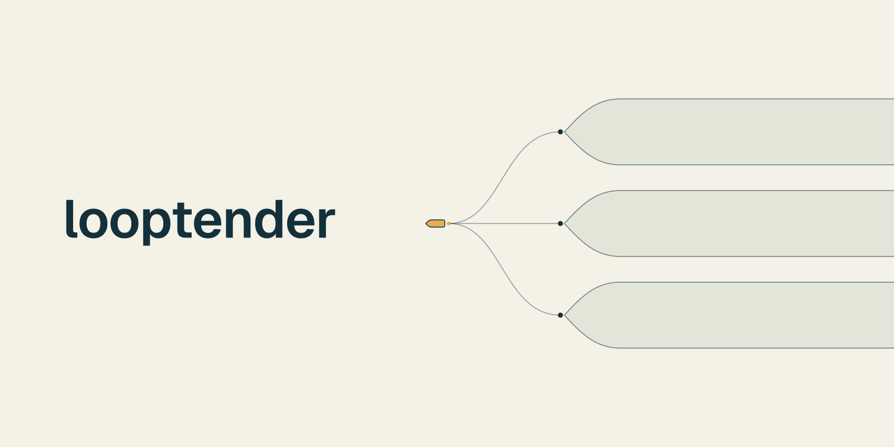
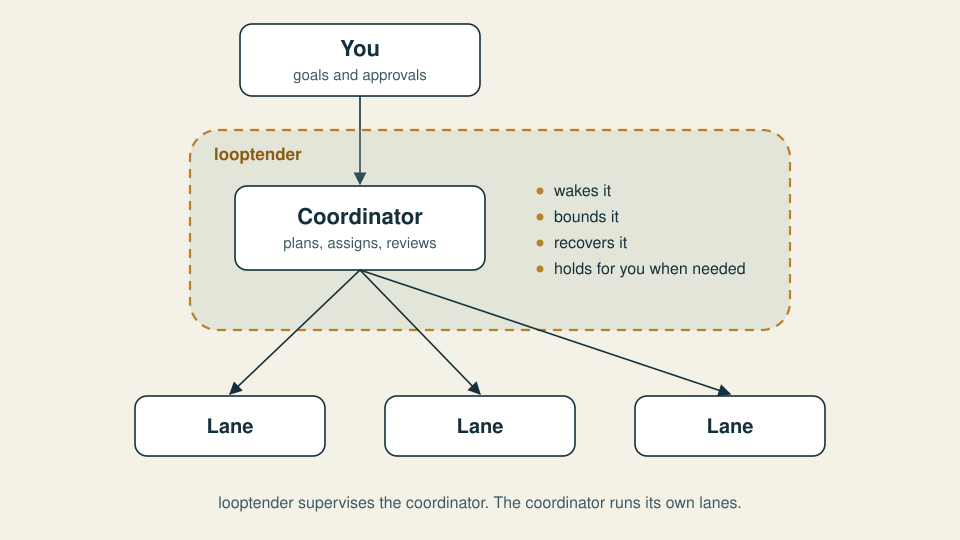
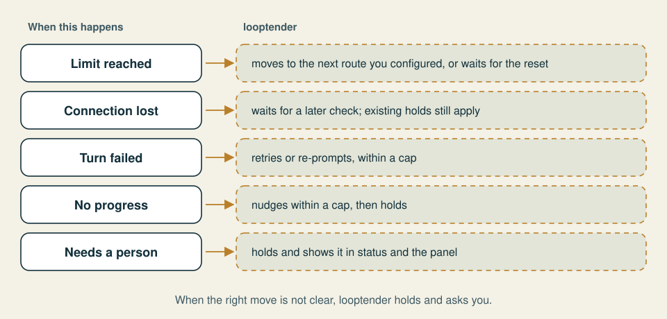
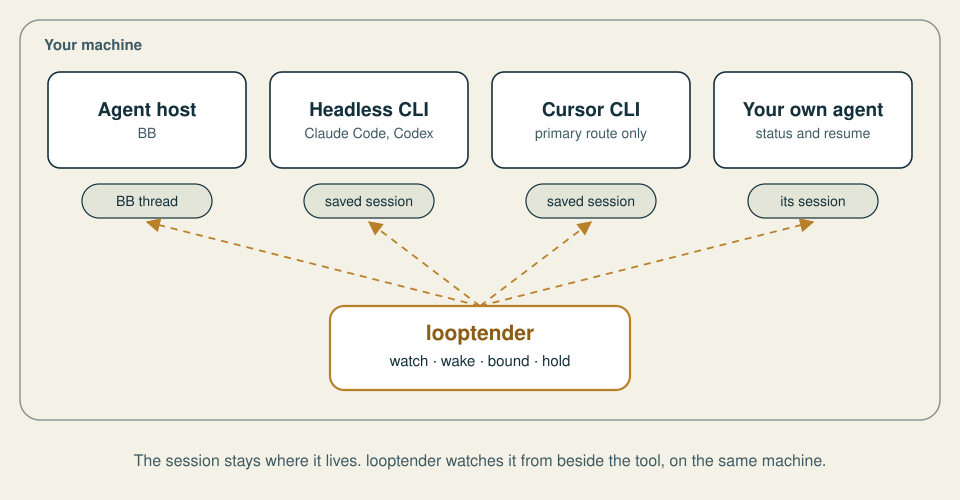

<picture>
  <source media="(prefers-color-scheme: dark)" srcset="docs/assets/looptender-banner-hub-dark.svg">
  <source media="(prefers-color-scheme: light)" srcset="docs/assets/looptender-banner-hub-light.svg">
  
</picture>

# looptender

looptender supervises a coding agent: it wakes an idle session, handles structured failures with bounded retries, and can hand off to a confirmed fallback when configured. Your agents do the work. looptender keeps their loops supervised, bounded, and visible.

<picture>
  <source media="(prefers-color-scheme: dark)" srcset="docs/assets/looptender-model-dark.svg">
  <source media="(prefers-color-scheme: light)" srcset="docs/assets/looptender-model-light.svg">
  
</picture>

In one line: you talk to one coordinator per project. The coordinator splits the work into lanes, picks a model for each lane that fits its task, and sends requests to the coordinators of your other projects, which can decline them. looptender keeps each coordinator going while you are away, and stops to ask you when something needs your approval.

The picture has three parts, using the words in the [glossary](docs/glossary.md):

- **You** are the person in the loop. Goals and approvals come from you, and a **hold** sends nothing until a person acts.
- A **coordinator** is the session you put under supervision: it hands out work and reviews it. Supervising that one session is a **loop**. looptender wakes it, keeps it within the limits you set, recovers it from structured failures and holds it for you when it needs a person. Coordinator is a role, not a setting: a session that delegates nothing is supervised the same way.
- **Lanes** are the conversations a coordinator starts for pieces of its work, each on the model the coordinator chose for it. For a BB loop looptender counts them and their state, so a working lane keeps the loop from being woken as idle; it retries a lane's failed turn when the loop opts in, and stops lanes when a person asks with `stop --lanes`.

There are two layers. The looptender supervisor watches, wakes, bounds, recovers and holds the coordinator's session and, on a limit, moves it to the next route you configured; the coordinator agent under it splits the work into lanes, chooses their models and talks to other coordinators. The supervised session can be a BB thread, a headless Claude Code, Codex or Cursor session, an agent defined in configuration, or another program described to looptender by its status and resume commands.

The core is a single binary for macOS, Linux and Windows. Use its daemon or an existing scheduler to check the loop. No separate loop skill is required. The host and supervisor must be running for checks to happen.

The goal is to grow from one loop on your machine to fleets of agents across machines, with clear ownership, bounded execution, and work that stays visible. Today, [supervision runs on the same machine as the agents](docs/architecture.md); [cross-device coordination is planned](docs/roadmap.md#loops-across-devices-planned).

## What it handles

These are the failures that stop an agent nobody is watching, and what looptender does about each today:

<picture>
  <source media="(prefers-color-scheme: dark)" srcset="docs/assets/looptender-failures-dark.svg">
  <source media="(prefers-color-scheme: light)" srcset="docs/assets/looptender-failures-light.svg">
  
</picture>

- **A provider limit is reached.** If you configured other routes, looptender moves the work to the next one in your list, in the order you gave, after one small real request confirms that route works. It is an ordered list, not a pool that it balances. Without other routes it waits, and a known reset time holds recovery until then. Returning to the first route is opt-in. The full [preferred routes](docs/roadmap.md#preferred-routes-planned) rule is partly implemented.
- **The network drops.** Before recovery work, looptender checks configured reachability so an unavailable connection can withhold re-prompts, handoffs and probes. Recovery still requires a running host, a later check and the usual holds and bounds. One real outage was observed; unattended lane recovery and the full network-cut procedure remain unverified ([evidence](docs/testing.md#observed-once-a-real-outage-2026-11-14)).
- **The machine goes away and comes back.** Nothing runs while the machine is off. Managed macOS and Linux [services](docs/services.md) can keep checks running when the user service manager is available; `status`, `doctor` and the panel show recorded check and service evidence. Live logout/reboot, sleep and recovery acceptance remains open, so installation alone does not establish that supervision will return.
- **A turn dies for no clear reason.** A failed BB turn is retried by reference. An error looptender cannot classify gets a limited number of re-prompts and then a hold, and it never moves the work to another route.
- **A loop spins without progress.** Nudges to a stalled session are capped, and when they are spent the loop holds for a person. Optional deadlines, send limits and a Git-based no-progress timeout bound the total.

Whenever the right move is not clear, looptender holds and asks you instead of deciding for you.

## How this differs from built-in loops

Agent tools have their own loops, retries and background agents, and each of them knows only its own tool. looptender runs on your machine outside any one tool and watches sessions in several of them. You do not do your development through it, and it is not another chat interface: each session stays where it lives, and looptender only watches, wakes, bounds and holds it.

<picture>
  <source media="(prefers-color-scheme: dark)" srcset="docs/assets/looptender-tools-dark.svg">
  <source media="(prefers-color-scheme: light)" srcset="docs/assets/looptender-tools-light.svg">
  
</picture>

## Where it works best today

BB threads get the most: lane awareness, retrying a failed turn by reference, and the BB plugin. Headless Claude Code and Codex sessions get the general behaviour (wakes, limited re-prompts with exact session resume, routes, limits and reports) but nothing for lanes. Cursor and Antigravity run as standalone first routes only and cannot be fallbacks ([Antigravity details](docs/antigravity.md)). Agents defined in configuration have been tested only with stand-ins. Much of the rest is fixture-tested and the full live walkthrough is unfinished; the table below says what has been verified where.

Generic process adapters retain at most 1 MiB of command stdout in unreleased source. Overflow reports an unknown outcome; it is not treated as a configured rate-limit exit. Excess bytes are discarded while the command finishes under its existing timeout. Headless Claude Code and Codex observations read at most 8 MiB of a completed turn; larger output stays unknown and supplies no session or limit evidence. Their private output files are not size-capped. These bounds do not add descendant cleanup or an automatic retry guarantee.

## Current availability

**Version guide: CLI [v0.2.0](https://github.com/looptender/looptender/releases/tag/v0.2.0) + BB plugin v0.3.0, from the same tag.** v0.2.0 is the first release under the [Sustainable Use License 1.0](LICENSE); v0.1.5 and earlier stay Apache-2.0. Its [release notes](docs/releases/v0.2.0.md) say what is new, what changes on upgrade and how to go back. Package evidence is [recorded here](docs/release-verification.md#v020-release-preparation). Check `keepgoing version` for the installed package. Installing a release does not upgrade a separately deployed supervisor executable or install the BB plugin or macOS companion.

Unreleased source adds `looptender session reset` to deliberately forget a saved Claude Code, Codex or resumable defined-agent session. It sends nothing and clears no hold; see [reset behavior and refusals](docs/operations.md#starting-a-new-conversation-on-purpose). This command is not in v0.2.0.

Unreleased headless runner completion requires wrapper protocol 3 (previously 2). Before upgrading, stop supervision and let old detached turns finish, or use owned stop and confirm actual exit, then replace/restart. The handshake protects new launches only; see [completion and upgrade limits](docs/operations.md#owned-headless-cancellation).

| Surface | What you can use | Verification boundary |
| --- | --- | --- |
| Core CLI | Setup, start, controls, bounds, diagnostics, goals and BB transfer | v0.2.0 adds network-aware recovery, the panel and the rest in its [notes](docs/releases/v0.2.0.md); broad offline tests, with partial live BB evidence |
| Headless Claude Code / Codex | New sessions, saved-session resume and configured account environments | Implemented; full live multi-turn, cancellation and separate-account handoff checks remain open |
| BB plugin | Setup, status, controls and transfer for plugin-created loops | Separate installation; newer UI flows are fixture-tested, with live deployment verification open |
| macOS menu preview | Local loop list; pause, stop and resume a loop after a native confirmation showing the panel's review | Developer build only; no confirmation answered by a person yet; packaging and accessibility verification remain open |
| Panel page | `keepgoing panel` and `keepgoing dock`: a local page for every registered loop, on 127.0.0.1 only; with `keepgoing panel --allow-changes`, pause, stop and resume from it; unreleased builds also offer reviewed per-loop binary replacement | Released in v0.2.0; fixtures only. Configuration, a tray item on other platforms, installation and remote access are planned |
| Cursor CLI | Primary-only adapter, guided setup and doctor checks (v0.2.0) | Offline fixtures; one CLI version inspected on macOS, with one live walkthrough of first turn, resume and stop; cannot be a fallback; existing IDE-chat attachment remains open |
| Agents defined in configuration | `adapter: custom` (v0.2.0): describe another command-line agent by its documented interface ([format](docs/configuration.md#an-agent-defined-in-configuration)) | Offline fixtures with stand-in agents; no real agent has been run from a definition, and guided setup does not create one |
| Antigravity CLI | Primary-only ACP adapter (`adapter: antigravity`, `agy acp --stdio`), doctor checks, and model-free `/usage` account quota (unreleased source) | Offline fixtures + live `agy 1.5.13` macOS checks (`initialize`, 2-turn `session/new` → `session/resume`, `/usage`); cannot be a fallback; guided setup creates disabled loops; installed macOS two-turn/resume/stop evidence is recorded; live macOS permission holds and manual same-session report completion verified; unattended permission recovery, installed Linux/Windows checks, chat-only questions and existing IDE-chat attachment remain open |
| Telegram remote channel | Unreleased source: `looptender telegram setup\|status\|test\|poll\|topics\|disconnect` and `loop.report.format: telegram` over outbound HTTPS with a personal `@BotFather` bot ([design](docs/telegram.md)) | Offline HTTP stand-ins only; no live Telegram Bot API check yet. Polling supports `/status`, `Pause`, `Stop` and ticketed `Resume`, with per-loop topics; opt-in `chat` steering (`TG5`) remains planned |

Unreleased source also allows Windows readers to retain a headless turn record while its replacement is published; [turn-record fixture evidence](docs/testing.md#windows-turn-record-publication) covers that record only. Completion publication and cleanup now stay under the turn lock, with shared completed-status reads fencing rollover. This is fixture-tested source behavior, not installed-service or live-provider acceptance.

The v0.2.0 changes are **not in v0.1.5**: among them network-aware recovery and BB turn retry by reference, holding back nudges to a hung turn, noticing a stopped scheduler, one loop per session, the panel and its controls, agents defined in configuration and the Cursor adapter. The [release notes](docs/releases/v0.2.0.md) list them all; a loop that has run on v0.2.0 needs [these steps](docs/releases/v0.2.0.md#going-back-to-v015) before v0.1.5 can run it again. See the [changelog](CHANGELOG.md) and [release evidence](docs/release-verification.md) for exact scope.

The complete live setup → multiple turns → hold → restart → recovery → completion walkthrough is still unfinished. Existing tests and package installation do not establish readiness to migrate other threads. The [roadmap](docs/roadmap.md) tracks those acceptance checks separately from implementation.

## Install

With Homebrew on macOS or Linux:

```sh
brew install looptender/tap/looptender
looptender version
```

The [Homebrew formula](https://github.com/looptender/homebrew-tap) packages v0.2.0's `keepgoing` binary and provides `looptender` as a symlink to it. Both names run the same released code. Installation and upgrade fixtures passed on macOS arm64; Intel macOS and Linux remain unverified. Existing installations need their tap receipt and command conflicts checked before changing packages; see the tap's [installation guidance](https://github.com/looptender/homebrew-tap#existing-installations).

Or download a [release archive](https://github.com/looptender/looptender/releases/tag/v0.2.0) for macOS, Linux or Windows and verify it against the published SHA-256 checksums. The archives contain `keepgoing`. The [package verification record](docs/release-verification.md) identifies the paths tested; not every OS/architecture has had a native installation walkthrough.

With Go 1.24 or newer:

```sh
go install github.com/connorburgess/keepgoing-agents/cmd/keepgoing@v0.2.0
```

The Go command above installs the released `keepgoing` executable. For unreleased source, `go install github.com/looptender/looptender/cmd/looptender@main` installs only `looptender`. That module's `@latest` needs a release declaring the same module path; use the pinned command above for v0.2.0.

Examples below use `keepgoing`, available from the release archives and Homebrew. With a source install, substitute `looptender` and set the BB plugin's `keepgoingPath` to its absolute path if needed. Existing schedulers need the executable named by their saved command; a source install creates no `keepgoing` alias. Source-only features are marked **unreleased**.

`go install` with `@latest` selects a tagged release, not `main`. These builds report `dev` because they lack the release build label; inspect `go version -m /path/to/keepgoing` for the module version. Prebuilt archives carry an embedded version label.

[CLI v0.2.0 and BB plugin v0.3.0](docs/releases/v0.2.0.md) are released from one tag. If your package source still provides v0.1.5, use a published v0.2.0 archive. The plugin has a separate [pinned installation path](integrations/bb-plugin-keepgoing/README.md#install); Homebrew does not install it.

### Development build

On macOS/Linux, keep a source build separate from the installed release:

```sh
git clone https://github.com/looptender/looptender.git
cd looptender
revision=$(git rev-parse HEAD)
mkdir -p "$HOME/.local/bin"
go build -trimpath -ldflags "-X main.version=dev-$revision" \
  -o "$HOME/.local/bin/keepgoing-dev" ./cmd/looptender
"$HOME/.local/bin/keepgoing-dev" version
```

Substitute that absolute binary path for `keepgoing` below. Record its revision when testing; building does not replace an existing loop's executable or timer. See [binary smoke checks](docs/release-verification.md#check-an-actual-binary-without-provider-calls).

## Quick start

Install and sign in to a supported agent CLI first, or use an existing BB thread. From an existing Git project with at least one commit:

```sh
keepgoing init
```

1. Choose a task, an agent and operating limits. The default is one agent with no fallbacks.
2. Review the plan. Creation writes a **disabled** private setup outside the checkout; it does not run agents, probes, logins or a scheduler.
3. Run the exact `doctor` command printed by setup. Review its warnings and unavailable checks; credential presence does not establish usable quota.
4. Run the printed `start --foreground` command to enable and supervise the loop. Use `--background` to detach instead. Background mode installs no service and does not restart after a crash or reboot.

Use the generated config path for subsequent commands. A build from `main` names it `looptender.yaml`; a released CLI (v0.2.0 and earlier, which Homebrew and `go install` give today) writes `keepgoing.yaml`, which every build reads the same way. For example, replacing this fictional path with yours:

```sh
keepgoing status -c /private/example-loop/looptender.yaml
keepgoing pause -c /private/example-loop/looptender.yaml --note "reviewing by hand"
keepgoing resume -c /private/example-loop/looptender.yaml
keepgoing stop -c /private/example-loop/looptender.yaml
keepgoing stop --lanes --immediately -c /private/example-loop/looptender.yaml
keepgoing complete -c /private/example-loop/looptender.yaml --note "Task verified"
```

A plain `stop` is carried out by the next check and stops the supervised conversation only; `--lanes` also stops the conversations it started, and theirs, and `--immediately` carries the stop out in the command ([stopping the lanes too](docs/operations.md#stopping-the-lanes-too)). `complete` saves a completion hold; it is a declaration by the agent or operator, not independent verification. `resume` explicitly clears pause, stop, awaiting-user and completion holds; a resume of a hold that looptender raised because its re-prompts or nudges were spent also starts the counts over. Existing holds remain intact when starting or restarting a supervisor. Unreleased Antigravity status diagnostics expose a recognized saved ACP session ID and manual `--conversation` guidance; they do not start a CLI, approve a request, or release supervision holds. Replying in the agent conversation does not resume supervision. A person explicitly resumes from the looptender menu/panel or an ordinary terminal outside BB; if `resume` reports a conflicting `BB_THREAD_ID`, use that reviewed person-facing path rather than transferring ownership. Status displays may update on their next refresh. Unreleased CLI output labels a question retained after completion as history: completion ended that wait, and the historical note does not require resuming the completed loop.

In v0.1.5, repeated control writes advance the loaded timestamp even when the system clock repeats or moves backwards, so an older registered-resume ticket cannot overlook a repeated pause. This is covered by offline tests; v0.1.4 does not include the correction.

In unreleased source, a running daemon can carry out a saved stop from its last loaded configuration when a source file becomes unavailable, with the same ownership, transfer and session checks. Nothing that continues work uses that configuration. The daemon records one error-report attempt per unavailable-configuration episode and exposes the cause through its live diagnostics and the panel. An attempt is not guaranteed delivery. Stop supervision before renaming or moving its configuration file; service restarts and external ticks have no retained configuration. See [configuration file recovery](docs/operations.md#when-the-configuration-file-is-unavailable).

looptender also checks control-file contents between daemon passes, so equal file size and modification time cannot hide a pause or stop. On Windows 10 version 1709 or newer, its control readers and writer, and those of `state.json` and the other records a tick replaces, support replacement while a snapshot is open. If a `state.json` save still fails, the tick has already acted and the next one can repeat a stop or prompt; the same applies on other systems. Control/goal writes require a filesystem supporting POSIX-style rename and fail if unsupported; the other records fall back to an ordinary rename there. v0.1.5 detects those changes through file metadata alone and lacks this reader-sharing fix. Unreleased source adds private `.present` marker files on Windows so an existing record cannot be mistaken for a new one during replacement, while never-written records return immediately. The Antigravity current-turn pointer uses the same shared readers and marked replacement in unreleased source; immutable turn records remain create-once. Concurrent older writers are not covered; deliberate record deletion must remove its marker too. Scheduler-driven ticks already reload controls on every invocation; see [control detection](docs/operations.md#control-change-detection).

The quick start needs v0.1.2 or newer. For v0.1.1 use its [tagged documentation](https://github.com/looptender/looptender/tree/v0.1.1). Follow the [setup guide](docs/setup.md) for scripted setup, accounts, bounds, Windows command syntax and private paths. Advanced configurations are in [examples](examples/); release users should use examples from their matching tag.

## How it connects to models

looptender uses the agent host's existing credentials and permissions:

- **BB:** select an existing thread. BB runs its provider/model; looptender observes structured state and sends control/messages through the BB CLI. It does not switch the thread's login or re-parent threads. It creates a thread in one case only: a handoff to a fallback that opted in with `bb.new_thread` ([details](docs/fallbacks.md#hand-off-to-a-new-conversation)).
- **Claude Code or Codex:** the installed CLI runs a new headless session on the first wake and resumes its saved session afterward. By default it inherits the launching environment and provider configuration. `init --account-dir` can select an existing account directory; `--model` selects a headless model. Setup does not attach to existing IDE or headless chats.
- **Process adapter:** supply structured status and resume commands for another system. Unreleased source adds `keepgoing adapter check` to check one configured status observation against the [adapter contract](docs/adapters.md#the-adapter-contract). It invokes no resume/stop command and does not itself write loop state; the status program is not sandboxed. This is an integration contract, not verified support for every IDE.
- **Cursor CLI:** a primary-only print runner resumes its exact saved session and uses the same control holds. Use `init --agent cursor`; setup discovers the `agent` executable and inherits existing credentials, and `doctor` checks the CLI version and stored login. Cursor must already trust the project directory. Its CLI has no structured failure classes, quota or model identity, so every failure stays unknown and Cursor cannot be a fallback; existing IDE-chat attachment remains unfinished. Offline fixtures plus one live walkthrough on one CLI version on macOS; see [Cursor setup and evidence](docs/cursor.md).

Cursor and Antigravity are [parallel integration tracks](docs/roadmap.md#6-cursor-and-antigravity-integrations), beginning with their CLI sessions. The published v0.2.0 CLI includes the primary-only Cursor adapter; unreleased source adds the primary-only Antigravity ACP adapter (`adapter: antigravity`, `agy acp --stdio`) and model-free `/usage` quota reads ([Antigravity setup and evidence](docs/antigravity.md)). Controlling an existing graphical IDE chat has separate verification gates.

## Fallbacks: several subscriptions, accounts or models

New to this? [Add an account, a subscription or a model](docs/accounts.md#add-an-account-a-subscription-or-a-model) has the commands in one place.

A loop can name other agents to move to when its current one reports a usage limit: another provider, another account of the same provider, or another model with its own limit. Each fallback uses a login you already set up. Supervision never logs in, creates accounts or copies credentials. The separate, person-started Accounts connection flow can open a provider sign-in after explicit review; it does not alter a loop’s routes or clear its holds.

- **Handoff order.** Fallbacks are tried in the order listed in `fallbacks.yaml`. A candidate takes over only after passing an exact probe, one small real request on its own account and model, during the same check.
- **Quota groups.** Every agent has a `group` label naming the usage limit it draws on. Fallbacks in the active agent's group are skipped, so accounts sharing a limit must share a label. looptender cannot verify which subscription a directory signs in to; a wrong label gives false redundancy.
- **Opt-in.** A loop without other routes never hands off. `init` creates a single-agent loop with handoff off, unless you give it fallbacks or it follows your [standard route list](docs/routes.md): the wizard offers that when you keep one (yes is the default), and a script asks for it with `--routes standard`; either way handoff is then on for rate limits (`failover_on: [rate_limit]`). Handoff happens only for the structured error classes in `errors.failover_on` and only while the redundancy rule is met. Unknown errors never trigger it. Returning to the primary is manual unless `switch_back` is enabled. In a hand-written config an absent `errors.failover_on` means `rate_limit`, so pointing `loop.fallbacks` at a file turns handoff on; `fallbacks add` never does that as a side effect and writes an explicit empty setting unless you choose handoff.
- **Probes cost quota.** Scheduled, exact and manual probes are real model requests. `fallbacks check --dry-run` previews them without calling a provider.

Set fallbacks up at creation with `keepgoing init` (wizard, or repeated `--fallback`). To add one to an existing loop, there is a guided command:

```sh
keepgoing fallbacks add -c /private/example-loop/looptender.yaml
```

It looks up installed agent CLIs without running them, asks for the provider, account directory or BB thread, quota group and model, previews the candidate and the resulting handoff order, and writes only after confirmation. It leaves handoff off unless you turn it on, and refuses a candidate on the same login and model as an existing target. For a loop with no other routes it first offers to follow your [standard route list](docs/routes.md) instead, which turns handoff on for rate limits; only a typed yes takes it (unreleased). Flags with `--non-interactive`, `--dry-run` and `--json` script the same path. `fallbacks handoff on|off`, `fallbacks move` and `fallbacks remove` change an existing setup the same way: preview, then confirm.

What is established: fallback files, probes, redundancy, handoff and `init --fallback` for headless Claude Code and Codex are covered by offline tests with fake CLIs. `fallbacks add`, new in v0.2.0, is likewise tested only with fakes. A handoff between real, separately billed accounts has not been run end to end. The command also adds an existing BB thread, including the loop's own conversation on a second model; it cannot see which account BB uses for a thread, and says so in the preview. Cursor cannot be a fallback; process candidates need a hand-written entry. See [fallbacks](docs/fallbacks.md) and [account setup](docs/setup.md#existing-accounts-and-ordered-fallbacks).

In unreleased source, opt-in `loop.timing` applies step up, step down and return decisions on a BB loop's own thread at an idle turn boundary, before its ordinary wake. It sends no extra message. Steps need a restorable primary model and same-allowance routes in the loop's own fallbacks file; the standard list excludes those routes. Without steps, timing only collects readings. `status` previews the next boundary from recorded evidence. Unreadable controls/state or unresolved followed steps withhold the preview with unavailable evidence. See [timing](docs/configuration.md#timing).

Automatic model catalogue discovery and retirement/replacement policy remain [planned](docs/roadmap.md#11-useful-supervision-features-from-product-analysis). Updating a provider CLI, changing its selected model and upgrading looptender are separate operations. looptender does not silently upgrade model selections.

## Looping and setup

Task input is **copied once** into the generated `prompt.md`; changes to the original task file are not tracked. Future prompts reread the saved prompt file. Keep operating instructions stable and have the agent inspect current authorized sources before choosing work.

New setup prompts also ask the coordinator to verify a completed phase, reassess remaining work and take a concrete independent authorized next action. Repeated completion receipts do not establish progress. This guidance does not schedule work, grant permission or clear holds, and it does not rewrite existing prompts. See [phase settlement](docs/coordinating-lanes.md#completing-the-whole-objective) for the remaining coordination acceptance case.

For a revisioned task, [`goal create|revise|show`](docs/goals.md) stores private goal identity, title, references and revisions. Opt-in `loop.prompt_goal` includes the current specification in automatic prompts and handoffs. The goal commands and prompt transport are available in v0.1.4. In v0.1.5, `init --with-goal` and an explicit wizard choice create a goal referencing one private task snapshot, with stable wake policy and current-goal transport enabled. The rebuilt BB setup UI offers the same explicit goal choice; it requires the updated CLI and remains live-unverified. It does not update old queued messages, infer roadmap progress or verify acceptance.

Unreleased source also registers a local dock/panel reference after a successful explicit CLI `enable` or `start`. Existing clients discover it on their next read; no client restart is needed. Registration is discovery metadata, not proof that work is running. A publication failure warns separately and never repeats or rolls back the lifecycle operation. Existing loops are not scanned automatically; use `registry add -c <config>` to add a missing reference.

Unreleased source adds [bound BB reference publication and repair](docs/local-clients.md#bound-bb-publication-and-repair-unreleased-source). Confirmed plugin setup/start/transfer operations publish a CLI menu reference; existing configurations use explicit owner-preserving reconciliation. Plugin references and CLI registry coverage remain distinct, with provenance shown separately from supervision health. Reads never register, remove or retire loops, and publication failure never repeats a completed lifecycle operation. This is fixture-tested source, not an installed/live repair claim.

The [BB plugin](integrations/bb-plugin-keepgoing/README.md) offers a separate setup flow with preview, disabled creation, diagnostics and explicit start. In unreleased source it also adds a **Keep going** switch to BB's New thread screen: its **Send and keep going** button is the consent, after which the thread gets a setup with a loop-wide limit and supervision starts once, or is left switched off with the reason when the start is uncertain or the review-first setting is on. That control is fixture-tested only and has not been run in a real BB. It also supports held transfer for plugin-created loops. The CLI's [`transfer preview|apply|recover`](docs/transfer.md) preserves goals and holds while fencing stale targets. Both transfer paths remain fixture-tested rather than live-verified. Unreleased source adds [explicit cross-provider CLI transfer](docs/transfer.md#explicit-provider-change-unreleased-source) to an existing BB destination in the same project/environment/host/path, with destination labels required and old account/probe/timing settings cleared. It preserves holds and accounting and leaves awaiting-user; it never starts supervision. Unreleased plugin source adds [explicit attachment from the CLI registry](integrations/bb-plugin-keepgoing/README.md#attach-an-existing-loop-unreleased-source) for an already-owned existing BB target, including reference reconciliation after a manual provider handoff. It saves only the plugin reference and reports check failures separately from daemon responsiveness; it never starts or resumes supervision. Installed-plugin attachment/start acceptance, automatic handoff detection and cross-IDE continuity remain follow-up work.

Unreleased CLI source also provides [`transfer reconcile preview|apply|show`](docs/transfer.md#record-a-migration-review-unreleased), an explicit private checklist of predecessor direct lanes, worktrees and unfinished assignments. Status shows its unfinished, dormant and unresolved counts. This records a review; it does not move workers, change goals or holds, or verify migration execution.

For a manually created successor that uses a separate loop, unreleased [`transfer supersede`](docs/transfer.md#retire-an-obsolete-loop-after-a-manual-move-unreleased) permanently fences the obsolete loop without changing the successor or clearing holds. This source fence remains fixture-tested rather than live-verified.

<a id="the-keepgoing-panel-one-page-for-every-loop"></a>

### The looptender panel: one page for every loop

**Unreleased migration review:** The panel shows dated, historical assignment counts from a saved [migration review](docs/transfer.md#record-a-migration-review-unreleased). Unfinished declarations remain visible beside the loop; absent or unreadable evidence is not treated as completed work. The view grants no permission and takes no lane or supervision action.

`keepgoing dock` serves a read-only page to this computer only (`127.0.0.1`, with a per-run token in the address). It opens on a short picker of every [registered](docs/local-clients.md) loop with its state in one phrase, and lists the loops that need you or could not be read. Picking a loop shows its last decision, any hold, its preferred routes in order with the one its records name as current, each route's readiness and usage reading, a usage limit it moved off with the reported reset, its lanes, recent history and limits. The Routes view groups recorded route readings under consistent account assignments, keeping each route's windows separate; unassigned routes retain their configured labels. Unreleased Accounts and native-menu summaries show saved supported Codex buckets, windows and typed credit/limit detail; experimental Claude retrieval is limited to an inspected Darwin arm64 native artifact, with retrieval time and provider freshness unknown in both summaries. The Accounts page reads a separate bounded saved snapshot; opening it never refreshes a provider. Explicit quota refresh calls no model; see [quota sources and limits](docs/accounts.md#read-selected-context-subscription-quota). The Versions view lists where each looptender build runs on this computer (the panel, each loop's checks, daemon and service, and the BB plugin and macOS menu), against the newest release seen here, without running any of them. Missing or old evidence is shown as unknown or stale. In unreleased source, successful Codex probes also collect structured account usage without another model call; a failed usage lookup leaves probe health unchanged. It reads what existing commands read, runs no provider command, changes nothing, and stopping it leaves supervision running. In v0.2.0 and tested with fixtures only; it never changes anything; pausing, stopping and resuming from the page needs `keepgoing panel --allow-changes`, and unreleased source adds a reviewed [standard-route editor](docs/dock.md#configure-routes-in-the-panel) for a panel started outside BB with changes allowed. Loop-specific custom-list configuration remains in the CLI. See [the panel](docs/dock.md).

**Unreleased Accounts view:** The Accounts page counts registered selections only. Routes without an account binding are listed separately with their account unknown; route contexts do not establish separate subscriptions.

**Unreleased landing view:** the overview keeps the needs-you queue first, groups each loop with its recorded direct lanes in an expandable tree, and shows a bounded sample of recent events across loops. Supervision and lane observations stay separate; active does not establish progress or connectivity. It reuses the existing read-only feed. Full descendant navigation and per-child answer controls are not included. See [landing view and evidence limits](docs/dock.md#landing-view-and-evidence-limits).

The panel and dock display the looptender name in builds from `main` (unreleased); the commands remain `keepgoing panel` and `keepgoing dock`. An already running panel keeps its previous page until it is restarted with the updated executable.

`keepgoing panel` opens that page in your browser with one command and nothing to copy: it starts the panel's background process, for this computer only, when none is running, opens the page through a single-use address that becomes a session cookie, and the panel stops by itself when unused ([details](docs/dock.md#opening-it-with-one-command-keepgoing-panel)). Started with `--allow-changes`, it also lets a loop's page pause, stop and resume it, and in unreleased builds replace its own binary inside its configuration directory, each after a review and a confirmation ([details](docs/dock.md#changes-from-the-page-keepgoing-panel---allow-changes)). `keepgoing dock` serves a read-only page to this computer only (`127.0.0.1`, with a per-run token in the address). It opens on a short picker of every [registered](docs/local-clients.md) loop with its state in one phrase, and lists the loops that need you or could not be read. Picking a loop shows its preferred routes in order (`primary`, then each fallback), the one its records name as current, each route's readiness and usage reading, its lanes, last check and limits. Missing or old evidence is shown as unknown or stale. It reads what existing commands read, runs no provider command, changes nothing, and stopping it leaves supervision running. In v0.2.0 and tested with fixtures only; unreleased source adds a reviewed [standard-route editor](docs/dock.md#configure-routes-in-the-panel) for a panel started outside BB with changes allowed. Loop-specific custom-list configuration remains in the CLI. See [the panel](docs/dock.md).

**Unreleased source:** a controls panel opened outside a supervised thread offers **Change send allowance…** on each loop. Review the current allowance, counted attempts and proposed remaining attempts before saving a positive total such as 500. Saving preserves holds and counted sends; Resume remains a separate action. See [send allowance editing](docs/dock.md#change-a-send-allowance-unreleased).

**Unreleased source:** a change-enabled panel retains the BB thread that started it. Resume uses that thread’s ownership checks; pause and stop can still place holds broadly, and an immediate stop leaves its caller until last when included. A person-started panel acts like a terminal outside BB. The released v0.2.0 panel acts with no BB caller and does not apply these new caller restrictions or ordering. Later openings keep the original startup identity; explicitly stop and restart the panel to change it. [Control authority and limits](docs/dock.md#changes-from-the-page-keepgoing-panel---allow-changes).

### Optional macOS menu preview

In unreleased source, the menu displays **Open looptender Panel** and **Quit looptender Menu**; its existing `KeepgoingMenu` bundle/executable identity remains compatible. The [native menu preview](integrations/macos/README.md) opens the looptender panel (`keepgoing panel`) and lists each registered loop as a row, with its state in the panel's words, that opens that loop's page and, when looptender says which changes fit, Pause…, Resume… and Stop…. Each change shows the panel page's own review in a native confirmation (Cancel is the default) and acts only on the loop's control record as reviewed; Open Panel with Controls… starts the panel so its page can make changes, after saying who could then make them. A count beside the icon says how many loops need a person, and a `?` says the loops could not be read. It reads `keepgoing panel list` when started, when the menu opens and once a minute, with no provider call; it starts no supervisor. It is a developer build, not in the release archives; optional installation remains planned, and no confirmation has yet been answered by a person.

### Discord alerts (unreleased)

Set `loop.report.format: discord` for an existing ordinary-channel incoming webhook. Store the credential URL in `LOOPTENDER_DISCORD_WEBHOOK_URL` or the same variable in `report.secret_file`. The preset sends only bounded loop/device labels and an event, explicitly suppresses mentions and embeds, and requests a saved-message acknowledgement. It makes one attempt without redirects or interactive controls. See [Discord configuration](docs/configuration.md#discord-notification-preset). Local fixtures only; live Discord and phone delivery are unverified.

### Slack alerts (unreleased)

Set `loop.report.format: slack` to use an existing incoming webhook. Store its secret URL in `LOOPTENDER_SLACK_WEBHOOK_URL`, or the same variable in `report.secret_file`; there is no separate bearer token. Only bounded loop/device labels and an event name enter a plain-text block. Notifications make one attempt without redirects and never add interactive controls. A verified HTTP response is not phone receipt. See [Slack configuration and limitations](docs/configuration.md#slack-notification-preset). Local fixtures only; live Slack delivery is unverified.

### ntfy phone alerts (unreleased)

Set `loop.report.format: ntfy` to publish a bounded plain-text notification to an explicitly configured ntfy topic. It requires a bearer token, defaults to `LOOPTENDER_NTFY_URL` and `LOOPTENDER_NTFY_TOKEN`, and sends only the loop label, configured `report.source` device label and event name. It omits free-form report text and data, makes one attempt without redirects, and never adds phone controls. HTTP acceptance does not prove phone receipt. Configure topic access separately; a bearer token alone does not prove that other subscribers cannot read a topic. See [configuration](docs/configuration.md#ntfy-notification-preset). Local HTTP fixtures only; live phone delivery is unverified.

### Telegram remote channel (unreleased)

`looptender doctor --telegram --offline -c example.yaml` adds local pairing and saved-token-file presence checks. Use `--telegram-dir /private/example/telegram` for an explicit pairing directory. It never loads the token, exposes pairing identities, contacts Telegram, or verifies delivery/polling health. Environment credentials are not inspected.

The [Telegram remote channel](docs/telegram.md) is an outbound-only remote surface for reaching a device's loops from a phone through a personal `@BotFather` bot—no inbound port, no tunnel, and no hosted credential broker. Supervision stays on the machine you own using the logins already there.

In unreleased source (`TG1`–`TG4`), `looptender telegram setup|status|test|poll|topics|disconnect` validates a bot token via `getMe`, stores it in a private `0600` `token.env` file, locks `pairing.json` strictly to the paired `allowed_user_id` and `allowed_chat_id` via a one-time `?start=pair_<nonce>` deep link, and delivers redacted plain-text alerts via `loop.report.format: telegram` (`scheme: telegram-bot`) with `deliveries.json` history and single-attempt semantics. Default `alerts` mode sends redacted event summaries only; `--mode chat` requires explicit `--accept-non-e2e` because Telegram Bot API traffic is not end-to-end encrypted. Outbound `getUpdates` polling via `looptender telegram poll` supports `/status`, `Pause`, `Stop` and reviewed, single-use-ticket `Resume`. `looptender telegram topics` inspects per-loop topics; `--sync` creates missing topics when supported, with a single-DM fallback. Current coverage uses offline loopback HTTP stand-ins only; live Telegram verification, terminal QR rendering, remote diagnostics, background service wiring, and `TG5` (opt-in `chat` steering and unified `onboard`) remain open.

## Why

An agent can finish a turn before its task is complete, hang without progress, or encounter a usage limit. looptender applies explicit continuation and recovery rules so a person does not have to watch every turn.

Decisions use structured status: exit codes, JSON fields, HTTP status and provider events. looptender also makes one outbound request of its own: before re-prompting or handing off an errored session, or probing a fallback, looptender sends a plain `GET https://api.github.com/zen` with no identifier to learn whether the network is up, and waits if it is not. Turn it off or point it elsewhere with [`loop.network`](docs/operations.md#network-outages). Transcript prose is never a decision signal. Unknown errors get bounded re-prompts and then a human hold; they never trigger failover.

## What it does

- **Wakes, nudges and retries.** Idle sessions can wake at each ordinary check. Stall nudges and error re-prompts have separate caps/backoff. A failed BB turn is retried by reference, not prompted again. A BB loop may also opt in (`bb.children.retry_errored`, off by default) to having the failed turn of a lane retried the same way. A lane is never messaged or created; it is retried only with `bb.children.retry_errored` and stopped only by an explicit `stop --lanes`, and only typed fields of its event log are read, never message text. Working lanes and pending provider retries suppress duplicate work; pending human input requires attention. A session that is itself in error is recovered whether or not its lanes are working.
- **Bounds automatic work.** Optional deadlines, total send allowances and Git-based no-progress timeouts persist across turns and restarts. Failed sends count; resume does not refund them. These are not dollar budgets or proof of useful work. See [operations](docs/operations.md).
- **Confirms fallbacks before handoff.** Eligible configured fallbacks need health evidence and an exact-model probe. Known reset times can hold recovery while ordinary checks continue. Switch-back is opt-in; no configured fallbacks means no automatic handoff. See [fallbacks](docs/fallbacks.md).
- **One loop per session.** Two loops never act on one BB thread or headless working directory at the same moment: a check claims its session first, and one that finds it claimed by another loop sends nothing. Turning on a second loop on a supervised session is refused, naming the first, unless asked for. See [one loop per session](docs/operations.md#one-loop-per-session).
- **Preserves control and ownership.** Stop and holds take precedence on checks. A different BB thread needs explicit takeover; transfer keeps the loop held until explicitly resumed. In unreleased source, the supervised session cannot resume or retarget its own loop: the current target thread and anything the loop's supervisor started are refused. The check is cooperative, not an authentication boundary ([details](docs/operations.md#the-supervised-session-cannot-clear-its-own-hold)). Invalid or stale configuration can withhold provider operations, including stop, until repaired/reloaded.
- **Tells a session what supervises it.** In unreleased source, `context -c <config>` (text, or `--json` with `schemaVersion: 1`) prints a loop's supervision context: its name, adapter, target with its configured identity, recorded owner, holds, bounds with used and remaining (an unset loop-wide limit says unset), lane policy, the commands a session may run, and fixed statements of the authority looptender keeps. It reads the loop's records only: it writes nothing and queries no provider. Opt-in `loop.prompt_context` can append the context to automatic sends; it changes no authority or hold ([details](docs/operations.md#supervision-context-in-sends)). `context --here` finds the loop whose active target is the session running it, by `BB_THREAD_ID` (not checked with BB) or else by its exact working directory only, and prints that context, more than one when several loops target it, or `no loop targets this session`; it never counts a lane through its parent. Headless and process turns no longer inherit their supervisor's `BB_THREAD_ID`, though a supervisor on an older build passes it until restarted. See [supervision context](docs/operations.md#supervision-context) and [which loop supervises this session](docs/operations.md#which-loop-supervises-this-session).
- **Explains recorded failures.** `doctor` checks supported setup/access/status signals; `status` separates holds, historical checks and daemon evidence; `timeline` reads keepgoing-owned incident and notification records, and filters them by event kind, target and time. Missing evidence stays unavailable. See [diagnostics](docs/diagnostics.md). `runs` shows each loop's recorded runs, sends and chat/session references offline, by exact ID; it also shows which child conversations and which owner a loop is waiting on, from recorded checks; it opens no chat and does not say who holds a lock. See [run discovery](docs/run-discovery.md#cli-navigation-d3).
- **Reports attention and completion.** Signed webhooks support escalation and completion declarations. Unreleased source also adds redacted outbound Telegram alerts (`loop.report.format: telegram`, paired locally via `looptender telegram setup`; offline HTTP stand-ins only). Delivery history distinguishes transport/HTTP results from unverified human receipt. Reports require configuration; they are not an implicit notification service.
- **Runs with your host.** Use `start`, a daemon, an existing scheduler, or managed macOS/Linux [services](docs/services.md). `ci-wait` and `net-retry` are separate command helpers. Unreleased: an opt-in [PR backlog safeguard](docs/pr-backlog.md) adds bounded GitHub WIP evidence to ordinary wakes; `pr-backlog` also checks it explicitly. It neither prevents arbitrary branch creation nor grants merge permission. Windows service management remains planned.

## Limitations

- A disconnected host cannot run checks. looptender does not restart the BB host daemon. Generic errors do not establish an internet or host-disconnect cause; see [interrupted-turn evidence](docs/diagnostics.md#interrupted-bb-turns-and-host-availability).
- BB error classification needs structured provider events. Codex headless limit classification may query its app-server's structured rate-limit snapshot when a failed turn has no recognized code; unavailable evidence remains unknown. See [integration evidence](docs/integrations.md).
- Headless stop requests go to an owned wrapper, never a PID trusted from a file. Legacy turns without a stop key are refused. Acceptance is not proof of exit; abrupt wrapper death can leave descendants requiring inspection. [Cancellation details](docs/operations.md#owned-headless-cancellation).
- A BB fallback probe uses the local Claude/Codex CLI account, not the BB thread's login. Configure the probe account explicitly when needed; looptender cannot establish account equivalence from a label.
- Setup, transfer, multi-account recovery, installed-service lifecycle and menu interaction still have live verification gaps. Do not equate a compiled feature or passing fixture with a successful real-provider walkthrough.

## Where this is headed

The coordinator and lane model is already how a person can organize their work. Unreleased source adds the read-only supervision context command, opt-in context in sends, recorded BB context size, idle-wake spacing, a panel view of recorded direct lanes, and the `TG1`–`TG4` foundation and remote controls for the outbound-only [Telegram remote channel](docs/telegram.md) (offline stand-ins only). A narrow CLI path can explicitly move one BB loop to an existing thread on another provider, and the plugin can attach an existing compatible loop reference; neither establishes automatic migration or installed/live acceptance.

The remaining work includes continuity across supported adapters, cross-project transfer, healthy-lane ownership reconciliation, verified preferred-route return at safe turn boundaries, and the remaining Telegram remote controls (`TG5`: explicit opt-in `chat` steering and unified `onboard`). Task, goal and hold reconciliation, automatic dispatch and broader cross-adapter return remain open. [Coordinating lanes](docs/coordinating-lanes.md) describes the coordinator's role; the [roadmap](docs/roadmap.md#5-conversation-setup-and-durable-supervision-continuity) separates implemented source, plans and remaining acceptance. No roadmap item upgrades a running supervisor or clears an existing hold.

## Documentation

- [Setup](docs/setup.md) and [configuration](docs/configuration.md): wizard, scripts, existing accounts and advanced settings.
- [Operations](docs/operations.md), [diagnostics](docs/diagnostics.md) and [services](docs/services.md): controls, failure evidence and background execution.
- [Goals](docs/goals.md), [transfer](docs/transfer.md) and [local clients](docs/local-clients.md) and [the panel](docs/dock.md): task metadata and optional integrations.
- [Agent chats](docs/agent-chats.md) and [BB plugin](integrations/bb-plugin-keepgoing/README.md): conversation supervision.
- [Integration evidence](docs/integrations.md), [testing](docs/testing.md) and [release verification](docs/release-verification.md): what was actually checked and what remains open.
- [Architecture](docs/architecture.md): how supervision, adapters and loops fit together; [examples](examples/) and [JSON Schemas](schema/) provide configuration contracts.
- [Roadmap](docs/roadmap.md): current priorities, planned scaling across devices and remaining acceptance gates; [feature analysis](docs/supervision-feature-analysis.md) gives checkable criteria.
- [Current scale limits and read-only benchmarks](docs/scale-baseline.md): local bounds, loss domains and measurement scope; no fleet capacity claim.
- [Where the supervisor runs](docs/command-center.md): design record on why looptender runs on the machine where the agents live, and how a person elsewhere is reached (mostly planned).
- [Telegram remote channel](docs/telegram.md): zero-infrastructure personal bot over outbound HTTPS (`TG1`–`TG5`); unreleased source includes `looptender telegram setup|status|test|poll|topics|disconnect` and `loop.report.format: telegram`, verified with offline stand-ins only (live Telegram verification, service wiring and `chat` steering remain open).
- [Glossary](docs/glossary.md): what loop, lane, route, device and hold mean.
- [Coordinating lanes](docs/coordinating-lanes.md): a convention for a conversation that hands out and reviews lane work; coordination decisions remain the coordinator’s; the opt-in backlog safeguard supplies evidence and a reminder.
- [Loops across devices](docs/devices.md): design only, nothing built; how a loop could move between a person's machines.
- [Standard route list](docs/routes.md): one ordered list of routes that loops can follow instead of a list each. Reading it is in v0.2.0. Unreleased: changing it with `keepgoing routes add`, `move`, `remove`, `off` and `on`, with a preview of every loop it affects; making a loop follow it or keep its own copy with `routes follow-standard` and `routes own`; and the offer to follow it in `init`, in guided `fallbacks add` and in the BB plugin's setup panel.
- [Licensing](LICENSING.md): what is free, what needs a commercial agreement, and what stays under Apache-2.0.

In unreleased source, the panel also has an [Accounts view](docs/accounts.md) for explicitly selected Claude Code and Codex contexts, with bounded explicit status checks and retained freshness. Codex checks additionally read allowlisted ChatGPT plan metadata through `account/read` with `refreshToken:false`; login evidence remains independent. New Codex plan metadata promotes the private catalog to schema 2; upgrade all catalog readers before writing it and preserve a compatible backup for rollback (see the Accounts guide). Login reports do not verify identity, quota or model access. An explicit `accounts usage --id ID` command, or reviewed subscription-quota action in `panel --allow-changes`, reads Codex subscription windows for that selected context without a model request. Unreleased CLI source additionally admits an inspected native Claude Code artifact through a parked, hook-checked `get_usage(skip_behaviors:true)` exchange; it never claims a session or sends a user message. Claude output carries retrieval time and unknown provider freshness because the native reply can conceal cached or seeded data. Wrappers and unreviewed builds refuse before launch. A panel with changes allowed advertises Claude retrieval only on Darwin arm64; each selection must still pass exact native-image and isolation admission. Web and matching native readers retain retrieval time and provider freshness unknown, never a newly observed provider reading. A separate private cache retains the original successful reading and failed-refresh evidence without changing the catalog schema. Page refresh only reads stored evidence; route observations and token totals remain separate. The execution sandbox marker does not select an account. Older definition-2 or changed-context bindings require an explicit reviewed same-selection update, then a separate quota read; they are never silently migrated. Accounts in a panel with changes allowed offers fixed-field same-selection recovery for Claude Code and Codex using its actual startup environment; it changes no authentication and verifies no identity. Native guidance directs recovery to that panel. Installed-panel acceptance remains open.

The unreleased Accounts connection flow replaces an unavailable-quota dead end with **Connect Claude** or **Connect Codex**. In a panel with controls enabled, review the selected account and start the provider’s sign-in, then finish authentication in the provider’s browser page. Each attempt uses a fresh private provider context; it does not overwrite an inherited login or another saved account. **Connect another account** uses an existing selection’s CLI and working directory as a template, asks for a new label, and adds a separate catalog entry only after verified sign-in succeeds. Connecting does not create a provider subscription, change routes, resume held loops or automatically read quota. A failed quota read alone is not treated as proof that login is missing. Native Connect actions open the matching Accounts row; they do not start authentication. Platform and executable admission still apply, and live sign-in acceptance remains unverified.

## Contributing

See [CONTRIBUTING.md](CONTRIBUTING.md) for commit sign-offs and the short [contributor agreement](CONTRIBUTOR_LICENSE_AGREEMENT.md). Use fictional data everywhere. Roadmap completion includes a [capability and documentation review](docs/testing.md#capability-and-documentation-review); documentation must distinguish implemented, released and live-verified behavior.

Panel frontend contributors also use [pinned browser guidance and an advisory
legacy-pattern scan](tools/modern-web-guidance/README.md), alongside Impeccable.
The scan is development tooling and does not establish browser compatibility.

## License

looptender is **source-available** under the [Sustainable Use License 1.0](LICENSE).

- Personal use and ordinary internal company use are free, including supervising your company's own agents and using your own installation in consulting or client work.
- You can inspect and modify the source, and share copies free of charge for noncommercial purposes while preserving the required notices.
- Selling looptender, incorporating its implementation into a commercial product such as an IDE, agent host or managed service, or offering it as a paid hosted service requires a separate commercial agreement.

An agent or tool that makes itself supervisable, or that calls a permitted looptender installation through its command line and JSON output, does not by itself require a commercial agreement. This is not an OSI-approved open-source license. Every release through v0.1.5 and other previously published Apache-2.0 material keeps its existing permissions.

See the [licensing guide](LICENSING.md) for examples, prior-version rights, and commercial inquiries. The license text governs.

In **unreleased source**, a person-started panel with changes allowed can replace a loop's own binary inside its configuration directory. Shared installations, agents, running daemons/services and Windows are refused. It retains the running source handle/hash, checks target identity, and keeps private backups. Undo lasts seven days and restores only the binary while record formats remain compatible. Existing loops on older builds need one manual binary replacement before executable identity is recorded. See [build replacement and manual recovery](docs/dock.md#changes-from-the-page-keepgoing-panel---allow-changes).

Unreleased source adds opt-in [Sessionpipe reporting](docs/sessionpipe.md): tier-0 loop events to a receiver you configure, with opaque identities, bounded best-effort delivery and a persistent report-only pause on HTTP 401 (`report resume` enables future reports without sending or clearing loop holds). This is fixture-tested OUT reporting only; it adds no supervision adapter, session intake, send/stop or hold-answer capability. Live receiver, board and phone acceptance remain open.

Unreleased: an opted-in BB coordinator can keep [explicit assignment handoffs](docs/assignments.md),
including an initial review of existing direct children, exact-revision acknowledgements and
dated status/panel counts. Missing evidence stays unknown. Its explicit awaiting-user check
rejects declared independent work; it does not schedule lanes, mandate turn-end handoffs or
clear existing holds.

Unreleased source separately adds opt-in [whole-objective completion review](docs/assignments.md#whole-objective-completion-review-unreleased). Explicit completion requires a current goal/review-bound declaration, completed acknowledged obligations and fresh direct-child metadata; zero children never prove objective acceptance. Default loops are unchanged. No automatic completion, new hold-clear permission or installed/live acceptance is claimed.

A separate unreleased `assignment_coordination` opt-in can wake that existing coordinator
once for a revision-bound declaration of independent unfinished work while a healthy
lane stays busy. [Readiness and attempt reconciliation](docs/assignments.md#opt-in-coordinator-wake-for-independent-work)
remain explicit. Missing/stale evidence withholds this exception; failed/unknown attempts
never automatically rearm. Ordinary task prompts, gates, cadence and send allowances remain.
This does not dispatch children, clear a saved hold or enforce handoffs at turn end.
