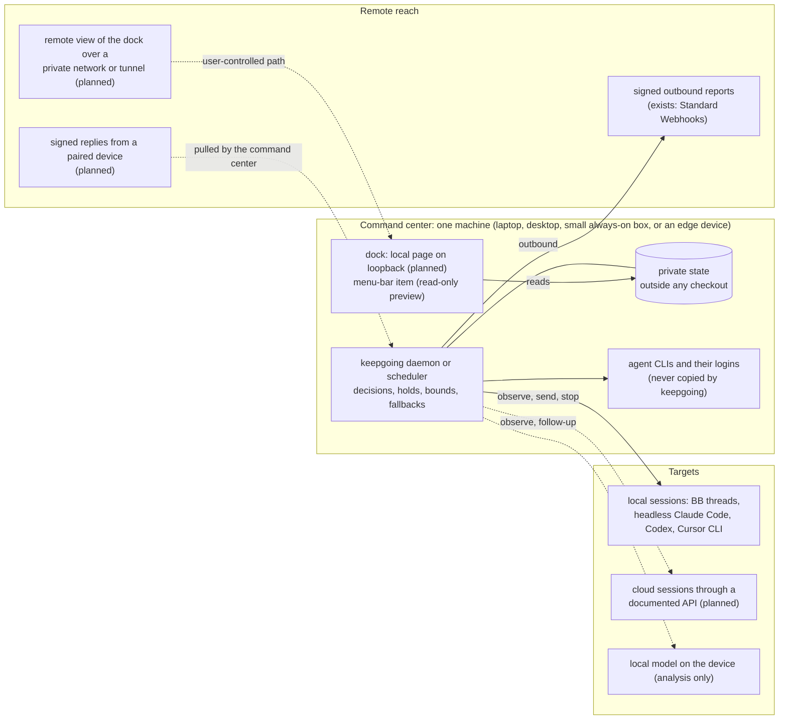

# Where the supervisor runs: the command center

Decision record and research, 2026-11-13. This page explains where keepgoing runs, where a person sees and controls it, and how that person is reached when they are elsewhere. Most of what it describes for the future is **planned, not built**; each section says which parts exist on `main` today. Vendor products change quickly, so every outside claim links to its source and gives the date the source shows, or the date it was read when the page shows none.

## The decision

keepgoing runs on one device, the **command center**: the machine where the agents and their logins already live. It is not a hosted service and holds no provider credentials of its own. A person looks and acts through the **dock**, a view onto that machine's local state, which may be on the same machine or reached from elsewhere. Running the supervisor locally and reaching it remotely are independent choices: remote reach is part of the model, delivered by outbound reports and, later, by a remote view over a path the user controls, never by moving the supervisor or its credentials to someone else's server. Cloud-hosted agent sessions are, later, one more kind of **target** the command center watches through a structured interface; supervising them is the case where the command center should be a machine that stays on. Edge devices that are offline much of the time are the strongest case for on-device supervision; there, the device is its own command center and has no dock of its own.

## The model

Words used here. "Command center" names the idea of supervising on the device; it is a design term, not a product label, and a machine running keepgoing is otherwise shown by its own name among a user's devices. "Dock" is a working name for the local page plus a small native presence item; user-facing text says "keepgoing panel" until a name is settled, since the word collides with the macOS Dock. A **route** is a model on an account at an effort level; configuration and code still say target, candidate and fallback, and nothing is renamed here. The [glossary](glossary.md) defines loop, lane, route and device.

Solid lines exist on `main`; dashed lines are planned or analysis.

- **Command center.** The process that checks loops (`keepgoing daemon`, `start`, a managed LaunchAgent or systemd user unit, or an external scheduler running `tick`) plus its private state directory. It runs the agents' own CLIs with the logins already on that machine; `keepgoing` never logs in, creates accounts or copies credentials ([README](../README.md#fallbacks-several-subscriptions-accounts-or-models)). This is how keepgoing works today.
- **Dock.** Where a person looks and acts. Today that is the CLI (`status`, `timeline`, `runs`, `pause`, `resume`, `stop`), the [registered client commands](local-clients.md) and an unreleased, read-only [macOS menu preview](../integrations/macos/README.md). A local page served on loopback is planned; its design so far is loopback-only, with a per-run token and no write endpoints. The only network listener keepgoing has today is the daemon's [diagnostic endpoint](diagnostics.md#live-daemon-diagnostics), bound to `127.0.0.1` and answering a challenge with a private key.
- **Remote reach.** How a person who is elsewhere learns what happened and, later, acts. Today: [signed webhook reports](configuration.md#report-yield-daemon) for handoff, holds, limit waits, child errors, completion, stop and errors, using the Standard Webhooks HMAC scheme. Nothing comes back: there is no inbound control path. Options for a remote view and for replies are set out [below](#reaching-the-dock-from-elsewhere).
- **Targets.** What the command center supervises. Today: BB threads, headless Claude Code and Codex, the unreleased Cursor CLI runner, and the generic process adapter ([capability matrix](adapters.md#matrix)). Cloud sessions and small-device targets are planned in the [runner kit](roadmap.md#runner-kit-one-contract-for-every-command-line-agent).

## What other tools do

Read 2026-11-13 from each project's own README, docs or changelog. "Control" means where the thing that decides and manages runs.

| Tool | Where control runs | Where agents run | Credentials | Continues idle or failed work by itself? |
| --- | --- | --- | --- | --- |
| [Conductor](https://www.conductor.build/changelog/0.92.0-remote-control) | Local Mac app; an iOS app steers local workspaces (Remote Control, 0.92.0, 2026-10-23). A hosted [Conductor Cloud](https://www.conductor.build/changelog/0.78.0-introducing-conductor-cloud) (0.78.0, 2026-07-30) is [closing](https://www.conductor.build/changelog/0.93.0-conductor-is-joining-meta): read-only on 2026-11-13, shut down 2026-11-20 (0.93.0, 2026-11-04). | Local worktrees; cloud microVMs while Cloud lasted | User's own keys or provider sign-in on the Mac | Not documented |
| [Vibe Kanban](https://github.com/BloopAI/vibe-kanban) | Local web app on 127.0.0.1 (`npx vibe-kanban`); remote access by the user's own tunnel. Hosted remote services [ended](https://www.vibekanban.com/blog/shutdown) (post 2026-04-10); the README says the project is sunsetting. | Local worktrees | User logs in to each agent CLI | No |
| [Claude Squad](https://github.com/smtg-ai/claude-squad) | Terminal UI; one tmux session and worktree per agent (v1.0.20, 2026-08-20) | Local | Each agent's own login | No; `r` resumes a paused session by hand |
| [Paradev, formerly Superset](https://github.com/ParadevAI/Paradev) | Local desktop app, optional cloud workspaces, iOS app; remote access needs the host kept awake | Local worktrees or cloud workspaces | "You bring your own agent subscriptions and API keys"; no model proxying | Not documented |
| [agtx](https://github.com/fynnfluegge/agtx) | Terminal kanban; optional phone access over the LAN or the user's tailnet with per-device tokens (v1.0.6, 2026-09-16) | Local tmux, optionally in a container | Agent's own, copied read-only into a container | An experimental orchestrator detects stuck tasks |
| [Omnara](https://github.com/omnara-ai/omnara) | Began as a phone companion; now "the open-source managed agent platform": hosted control at app.omnara.com or self-hosted, with an outbound `omnarad` daemon for tools on the user's machine (2026-11-13) | Omnara workers run the agent loop; tools in cloud sandboxes or locally | Stored by the platform and shared to projects | Yes, by durable state |
| [Happy](https://github.com/slopus/happy) | Phone, web and desktop companions; a CLI wraps Claude Code or Codex in the user's terminal; traffic is end-to-end encrypted through a relay the user can self-host | Local | User's own subscription | Not documented |
| [Hydra](https://github.com/rencryptofish/hydra) | The name is ambiguous; this is the closest match: a terminal UI with one tmux session per agent that recreates dead sessions on startup (last push 2026-02-25) | Local | Agent's own; launches with permission-skipping flags | On startup only |
| [unsnooze](https://github.com/saaranshM/unsnooze) | Local daemon and CLI, no hosted part; reaches other machines over the user's SSH (v1.21.2, 2026-11-01) | Local | Agent's own | Yes: after a usage-limit reset it types into the tmux or Zellij pane or runs the agent's resume command; detection includes terminal banners |
| CodePass | Not found. No coding-agent tool by this name could be identified; it is left out rather than guessed. | | | |

Vendor features, read 2026-11-13 (vendor pages show no dates):

- **Claude Code on the web** runs each session in "an isolated, Anthropic-managed VM", reached from the web, the mobile app, Desktop, `claude --cloud` and Slack ([docs](https://code.claude.com/docs/en/claude-code-on-the-web)).
- **Claude Code Remote Control** keeps the session on the user's machine and makes the web and mobile app a window into it. The local process "makes outbound HTTPS requests only and never opens inbound ports"; traffic goes through Anthropic and is not end-to-end encrypted; the remote side can send messages, answer permission prompts and stop subagents ([docs](https://code.claude.com/docs/en/remote-control)).
- **Claude Code auto-continue**: interactive subscription sessions wait at a usage limit and continue after it resets; `/goal` keeps starting turns until a model judges a condition met ([interactive mode](https://code.claude.com/docs/en/interactive-mode), [goal](https://code.claude.com/docs/en/goal)).
- **Codex cloud** tasks "keep working while your computer is asleep" ([docs](https://learn.chatgpt.com/docs/cloud)). Separately, Codex [remote connections](https://learn.chatgpt.com/docs/remote-connections) let a phone steer Codex on the user's own computer through "a secure relay layer" after QR pairing.
- **Cursor cloud agents** run in "isolated VMs in the cloud" or on the user's own workers ([docs](https://cursor.com/docs/cloud-agent)). Cursor's [mobile page](https://cursor.com/docs/cloud-agent/mobile) describes a mode where "the agent loop moves to the cloud while its tools keep running on your machine".
- **Devin** "works on its own VM", reached from the web app, a desktop app, a CLI and Slack ([CLI cloud docs](https://docs.devin.ai/cli/cloud)).

What this shows. Tools that run agents on the user's machine keep control there and reach the person through a companion or a tunnel (Conductor, Vibe Kanban, agtx, Happy, Claude Code Remote Control, Codex remote connections). Products whose control is hosted run the agent loop on their own infrastructure too (Omnara, the vendor cloud agents). Two hosted control layers for local agents closed in 2026 (Vibe Kanban's remote services, Conductor Cloud), while their local apps continue. That is consistent with the decision; it is not proof that hosted control fails.

## Interfaces cloud sessions offer an outside process

A cloud session can be a keepgoing target only if an outside process can read its state and continue it through a structured interface. Read 2026-11-13:

| Service | Read state | Continue work | Documented? |
| --- | --- | --- | --- |
| [Cursor cloud agents API](https://cursor.com/docs/cloud-agent/api/endpoints) | `GET /v1/agents/{id}`, `GET .../runs/{runId}`, an SSE event stream resumable with `Last-Event-ID` | `POST /v1/agents/{id}/runs` (follow-up, or steer a running agent); `POST .../cancel` | Yes, public beta, API key |
| [Devin API v3](https://docs.devin.ai/api-reference/v3/overview) | Session list and get (exact paths not confirmed) | `POST .../sessions/{devin_id}/messages`; a suspended session is resumed | Yes, service-user key or token |
| [GitHub Copilot agent tasks](https://docs.github.com/en/rest/agent-tasks/agent-tasks) | `GET /agents/repos/{owner}/{repo}/tasks/{task_id}` | No follow-up endpoint; continue by an `@copilot` pull request comment ([how-to](https://docs.github.com/en/copilot/how-tos/use-copilot-agents/cloud-agent/use-cloud-agent-via-the-api)) | Public preview |
| [Claude Code on the web](https://code.claude.com/docs/en/claude-code-on-the-web) | No documented API to list or read sessions | `claude -p "…" --cloud <session-id>` queues a follow-up but does not return the reply; [routines](https://code.claude.com/docs/en/routines) have a beta trigger endpoint that starts a new session | CLI only for follow-ups |
| [Codex cloud](https://learn.chatgpt.com/docs/developer-commands.md?surface=cli) | `codex cloud list --json`, `status` (experimental CLI) | No subcommand sends a follow-up to an existing task | CLI only |

Only Cursor and Devin document both halves, observe and continue, as an API today. A cloud-session target would also need a structured error class for limits and failures; none of these pages was checked for that, so it stays an open question for each. keepgoing supports none of them yet.

## Reaching the dock from elsewhere

None of this section exists. It sets out how a remote view and remote control could be added without moving the supervisor.

### How others do it

- **Vendor relays for local sessions.** Claude Code Remote Control: outbound HTTPS from the machine to Anthropic, claude.ai login with a URL or QR code, optional per-device trusted devices, TLS but not end-to-end encryption, and the remote side may send messages, answer permission prompts and stop subagents ([docs](https://code.claude.com/docs/en/remote-control)). Codex remote connections: QR pairing per phone and host on one ChatGPT account through a relay whose operator and encryption the page does not state; the phone can steer and approve commands ([docs](https://learn.chatgpt.com/docs/remote-connections)). VS Code Remote Tunnels: outbound connections to Microsoft dev tunnels, both ends signed in to the same GitHub or Microsoft account, with SSH inside the tunnel for end-to-end encryption ([docs](https://code.visualstudio.com/docs/remote/tunnels), page footer 2026-11-11). Happy: a relay that "only sees encrypted blobs", keys exchanged by QR, server self-hostable ([README](https://github.com/slopus/happy)).
- **Paths the user controls.** `tailscale serve` publishes a local port to the user's own tailnet only and adds the caller's identity in request headers; `tailscale funnel` makes it public, which is a different exposure ([serve](https://tailscale.com/kb/1312/serve), [funnel](https://tailscale.com/kb/1223/funnel), validated 2026-01). Tailscale's [relays](https://tailscale.com/kb/1232/derp-servers) forward traffic that is already WireGuard-encrypted; [Headscale](https://github.com/juanfont/headscale) replaces the control server for one self-hosted tailnet. Plain [WireGuard](https://www.wireguard.com/) authenticates peers by public key. SSH local forwarding (`ssh -L`) and reverse tunnels (`ssh -R`) reach a loopback port with keys the user already has ([ssh(1)](https://man.openbsd.org/ssh)). Hosted tunnels such as [Cloudflare Tunnel](https://developers.cloudflare.com/cloudflare-one/networks/connectors/cloudflare-tunnel/) (outbound-only, updated 2026-08-04, with Cloudflare Access for login) and [ngrok](https://ngrok.com/pricing) put a third party in the path.
- **Messages with a receiver.** With no inbound port, the machine keeps an outbound connection to a relay and pulls replies: Slack [Socket Mode](https://docs.slack.dev/apis/events-api/using-socket-mode/), Telegram [`getUpdates`](https://core.telegram.org/bots/api#getupdates) (Bot API 10.4, 2026-11-09), [ntfy](https://docs.ntfy.sh/subscribe/api/) streams and polling, Matrix [`/sync`](https://spec.matrix.org/latest/client-server-api/). Replies are authenticated by an HMAC over a timestamp and body with a freshness window (Slack [request signing](https://docs.slack.dev/authentication/verifying-requests-from-slack), five minutes), by message ID plus timestamp for replay protection ([Standard Webhooks](https://github.com/standard-webhooks/standard-webhooks/blob/main/spec/standard-webhooks.md), which also allows Ed25519 per-sender keys), or by per-device keys (Matrix). Weaker forms exist: GitHub's webhook HMAC has no timestamp ([docs](https://docs.github.com/en/webhooks/using-webhooks/validating-webhook-deliveries)), and ntfy's action buttons send an unsigned request ([docs](https://docs.ntfy.sh/publish/)).
- **Loopback is not a boundary by itself.** A browser can be made to send requests to `localhost`. The MCP transport specification requires servers to validate the `Origin` header against DNS rebinding and to bind to 127.0.0.1 ([2025-06-18](https://modelcontextprotocol.io/specification/2025-06-18/basic/transports)); OWASP recommends tokens, `Origin` and `Sec-Fetch-Site` checks and no state change on GET ([CSRF cheat sheet](https://cheatsheetseries.owasp.org/cheatsheets/Cross-Site_Request_Forgery_Prevention_Cheat_Sheet.html)).

### Options for the dock, least infrastructure first

| Option | What it costs | What it exposes | What must hold before remote control is safe |
| --- | --- | --- | --- |
| **0. Outbound reports only** (exists) | Nothing beyond a receiver the user already has | Event summaries, signed, to one configured URL | Read-only by design; nothing comes back |
| **1. Local page over the user's own private network or tunnel** (`tailscale serve`, WireGuard, `ssh -L`) | Free tiers or existing SSH keys; no server to run ([Tailscale personal plan](https://tailscale.com/pricing): 6 users, non-commercial) | The page to devices on the user's network; nothing public | The page must stop trusting "it came from loopback": a tunnel delivers remote requests to 127.0.0.1. Check `Host` and `Origin`, keep the per-run token, add a per-device credential before any write endpoint |
| **2. Signed replies through a receiver** (a reply to a report, pulled by the command center) | A message service the user chooses, or a self-hosted one | Report contents to that service; a narrow set of commands back | Per-device keys or HMAC with timestamp and message ID, replay rejection, and commands bound to the exact hold they answer (like today's [single-use resume ticket](local-clients.md#registered-resume)) |
| **3. A relay the user runs** (for example a self-hosted end-to-end encrypted relay) | A small always-on host: a few dollars a month (see [cost](#cost)) and its upkeep | Encrypted traffic to the user's own server | End-to-end encryption with keys paired on the devices, so the relay host can be compromised without granting control |
| **4. A hosted relay** | A service someone must run and pay for | Metadata, and contents unless end-to-end encrypted, to a third party | Everything in 3, plus trust in the operator for availability; the relay must never hold provider credentials |

What remote control would mean, in order of risk:

1. **Pause and stop** are restrictive. Today's `client pause|stop` only add a hold; a forged pause wastes time but cannot spend quota or act on a repository. These are the first candidates for remote writes.
2. **Resume** releases automatic work. It should reuse the existing prepared-resume design: a short-lived, single-use ticket bound to the loop's current evidence, so a delayed or replayed remote request cannot resume a loop that changed.
3. **Approving a handoff** moves work to another account or provider. It spends a different quota and needs the same binding to the exact handoff proposed.
4. **Answering a permission prompt** lets the agent do something it asked a person about. It is the most sensitive: it needs per-device authentication, a binding to that exact prompt, an expiry, and a record in the incident history of which device answered.

Recommended order: keep 0; build the local page read-only; document option 1 as the supported way to see it from elsewhere; then add pause and stop as the first write endpoints with Host/Origin checks, the per-run token and a per-device credential; then option 2 for answering holds from a phone, starting with resume through a ticket; consider 3 only if 1 and 2 are not enough; treat 4 as out of scope for this project unless it is end-to-end encrypted and holds no provider credentials. Approving a handoff and answering permission prompts remotely come last, after the local versions exist.

## Alternatives considered

### A hosted supervisor

A service that holds the user's provider logins or keys and supervises sessions from its servers.

- **Credentials.** Anthropic's Claude Code terms say developers "may not collect, store, or intermediate Claude.ai credentials or session tokens" and may not route requests through Free, Pro, Max or Ultra plan credentials on behalf of their users ([legal and compliance](https://code.claude.com/docs/en/legal-and-compliance), undated, read 2026-11-13). keepgoing's fallbacks depend on subscription logins. OpenAI's Codex sign-in page tells users to treat `auth.json` "like a password" ([docs](https://learn.chatgpt.com/docs/auth)); no statement on third-party services holding it was found.
- **Concentration of secrets.** Hosted services holding many customers' tokens are a repeated target: CircleCI asked all customers to rotate every secret after an engineer's session cookie was stolen ([report](https://circleci.com/blog/jan-4-2023-incident-report/), 2023-01-12); stolen Heroku and Travis CI OAuth tokens were used to clone private repositories ([GitHub](https://github.blog/news-insights/company-news/security-alert-stolen-oauth-user-tokens/), 2022-04-15); Codecov's modified uploader sent CI environment variables out for two months ([notice](https://about.codecov.io/security-update/), 2021-04-15); stolen Salesloft Drift OAuth tokens were used to export Salesforce data ([Google Threat Intelligence](https://cloud.google.com/blog/topics/threat-intelligence/data-theft-salesforce-instances-via-salesloft-drift), 2025-08-27).
- **Reach.** A hosted service cannot run or observe a CLI session on the user's machine without a local agent anyway; Omnara's hosted platform uses an outbound local daemon for that ([README](https://github.com/omnara-ai/omnara)). The local part would remain, plus a server.
- **Local-first.** The [local-first ideals](https://www.inkandswitch.com/essay/local-first/) (Kleppmann et al., Ink & Switch, 2019) include "the network is optional", "security and privacy by default" and "you retain ultimate ownership and control". A supervisor that keeps working during an outage and keeps logins where they already are follows them.

Not chosen. A hosted service is reasonable for cloud sessions whose vendor issues scoped API keys; see [where this is weakest](#where-the-decision-is-weakest).

### A supervisor inside each IDE

One supervisor per tool, built as an IDE extension or feature.

- No IDE documents a way for an outside process to observe and continue a chat already open in its window (keepgoing's [documentation review](adapters.md#chats-already-open-in-an-ide), 2026-11-13). An in-IDE supervisor would be per vendor.
- Moving work between providers and accounts on a limit, keepgoing's fallback chain, needs one place above all of them.
- Supervision would stop when the IDE closes. Vendors are adding their own continuation (Claude Code's auto-continue and `/goal`, above); keepgoing defers to those where they exist and covers the gaps between them.

Not chosen.

### Per-agent wrappers

A program that wraps each agent's process or terminal: Claude Squad, Hydra, Happy's CLI, unsnooze.

- Wrappers that drive a terminal type text into it and some read terminal output: unsnooze's limit detection includes terminal banners. keepgoing's rule is that decisions come from structured signals only, never from transcript or terminal text ([architecture](architecture.md#rules-that-do-not-bend)).
- A wrapper per agent repeats bounds, holds and fallbacks per agent; keepgoing already shares them across adapters, and the runner kit makes a new agent a small specification rather than a new wrapper.

Not chosen as the architecture. keepgoing's headless runners do own the turn process they start, with owned cancellation; they are an adapter, not the place where decisions live.

### Phone first

The phone as the place where control lives.

- Every phone product found is a companion to a machine or a cloud: Happy, Claude Code Remote Control, Codex remote connections and Conductor's Remote Control all steer sessions on a computer; Paradev's remote access needs the host kept awake. None runs the agents on the phone.
- A phone is the right **dock** when the person is away, which is why remote reach is part of the model. It is not the right command center.

Not chosen as the command center; kept as a dock.

## Edge devices and local models

Analysis and planned direction. keepgoing does nothing in this section today.

An edge device that is offline much of the time, such as a wearable camera running agents in a small virtual machine to process what it records, is the strongest case for on-device supervision: a cloud supervisor cannot reach it while it is offline, and its data can stay on the device. The device is its own command center. It has no screen for a dock; its view is remote, through reports queued until a connection returns and a remote view when one exists.

Edge platforms already work this way. The supervisor and the workload run on the device; the cloud holds desired state and a dashboard; the device keeps working offline and reconciles when it reconnects:

- **systemd** restarts a failed unit (`Restart=`) and kills and restarts one that misses its watchdog (`WatchdogSec=` with `sd_notify`), entirely on the device ([systemd.service](https://www.freedesktop.org/software/systemd/man/latest/systemd.service.html), [sd_notify](https://www.freedesktop.org/software/systemd/man/latest/sd_notify.html)).
- **balena** runs its Supervisor in a container on the device so the device "can continue running and pulling new code even if your application crashes"; an offline device learns about new releases when it reconnects, but dashboard actions such as restart are not queued and are lost if it is offline ([primer](https://docs.balena.io/learn/introduction/primer), [actions](https://docs.balena.io/learn/manage/actions), undated).
- **AWS IoT Greengrass v2** devices "react autonomously to local events"; outbound messages are spooled (2.5 MB in memory by default, or on disk), shadows sync when connected, and updates need a connection ([overview](https://docs.aws.amazon.com/greengrass/v2/developerguide/what-is-iot-greengrass.html), [nucleus](https://docs.aws.amazon.com/greengrass/v2/developerguide/greengrass-nucleus-component.html), undated). The lite nucleus needs 15 MB of RAM ([lite](https://docs.aws.amazon.com/greengrass/v2/developerguide/greengrass-nucleus-lite-component.html)).
- **Azure IoT Edge** devices that have connected once "can keep operating indefinitely" offline; edgeHub stores messages and reconciles twins on reconnect; the minimum is 256 MB RAM on AMD64, ARM32v7 or ARM64 ([offline](https://learn.microsoft.com/en-us/azure/iot-edge/offline-capabilities), 2026-03-02; [support](https://learn.microsoft.com/en-us/azure/iot-edge/support), 2026-10-30).
- **K3s** is a single binary under 100 MB for edge and ARM boards; an agent node needs 1 core and 512 MB ([requirements](https://docs.k3s.io/installation/requirements), 2026-11-09). Its documentation found here does not say how a node behaves when cut off from its server.

What keepgoing has toward this: release archives are built for `linux/arm64` ([build script](../scripts/build-release.sh)), but the recorded package checks run only the macOS arm64 executable ([release verification](release-verification.md)); no small ARM device has run keepgoing. Its systemd user unit uses `Restart=on-failure` and never enables login lingering ([services](services.md)), so on a device without a login session it would not start at boot today. Network-aware waiting, which an often-offline device needs most, is an open pull request, not on `main`.

### Local or remote model

On such a device the agent's model can be local or remote:

| | Local model | Remote model |
| --- | --- | --- |
| Per-token cost | None | Metered or limited by plan |
| Offline | Works | Waits for a connection |
| Capability | Limited | High |
| Device budget | Compute, memory, power, heat | Radio and battery for the connection |

What small models do on embedded-class hardware, from primary sources:

- **Jetson Orin Nano Super** (8 GB, 7 to 25 W modes, $249): Llama 3.2 3B at 43 tokens/s and Llama 3.1 8B at 19 tokens/s decoding, INT4 with MLC ([NVIDIA](https://developer.nvidia.com/blog/nvidia-jetson-orin-nano-developer-kit-gets-a-super-boost/), 2024-12-17). Vision-language figures in the same post are around 1 per second for VILA 1.5 3B and 13 for SmolVLM 2B; NVIDIA labels them tokens per second, and the units could not be confirmed.
- **Raspberry Pi 5** (8 GB, CPU only): Gemma 4 E2B decodes at about 9 tokens/s with LiteRT-LM, and about 4 to 7 with llama.cpp Q4_0 (the article gives both figures) ([Raspberry Pi](https://www.raspberrypi.com/news/mastering-edge-ai-on-raspberry-pi-with-litert-and-gemma/), 2026-08-11); llama3.2:3b through Ollama decodes at 4.6 to 4.9 tokens/s with a measured peak of 12 to 14 W ([geerlingguy/ai-benchmarks](https://github.com/geerlingguy/ai-benchmarks), 2026-09-22).
- **Phone-class NPU**: Llama 3.2 3B at 26.5 tokens/s on Snapdragon 8 Elite, w4a16 ([Qualcomm model card](https://huggingface.co/qualcomm/Llama-v3.2-3B-Instruct), 2026-11-05).
- **Capability gap.** On the Berkeley Function Calling Leaderboard V4 (2026-04-12), Claude Opus 4.5 scores 77.5% overall and 68.4% on multi-turn tool use; Qwen3-8B 42.6% and 41.8%; Llama 3.2 3B 22.0% and 4.0%; Gemma 3 1B 7.2% and 0% ([BFCL](https://gorilla.cs.berkeley.edu/leaderboard.html)). On SWE-bench Verified the top agents reach 79.2%, and the best entries under 8B parameters 23.2% ([SWE-bench](https://www.swebench.com/), latest entry 2026-02-26). Small models can follow a fixed procedure; multi-step coding work with tools is where they fall short.

**Continuous media.** A fixed vision pipeline runs per frame in real time: a YOLO26n detector takes 3.8 ms per 640-pixel image on an Orin Nano Super with TensorRT INT8, and 67 ms on a Raspberry Pi 5 ([Jetson guide](https://docs.ultralytics.com/guides/nvidia-jetson/), [Raspberry Pi guide](https://docs.ultralytics.com/guides/raspberry-pi/), both 2026-11-07). A language-model answer on the same hardware takes seconds. Per-frame work is not something an LLM agent loop does live. The fitting split is: a fixed local pipeline processes video as it is recorded; an agent authors or adjusts that pipeline, and reviews its results afterwards in batches; keepgoing would supervise the agent, not the pipeline. The pipeline itself belongs under an ordinary process supervisor such as systemd.

**What this implies for keepgoing (planned direction).**

- **Connectivity-aware routing** is a form of the [fallback chain](fallbacks.md) that already exists: an ordered list of targets, each confirmed before use. The planned policy is [preferred routes](roadmap.md#preferred-routes-planned): a loop has an ordered list of routes, work does not stop while any route can take it, and it returns to the most preferred available route at a turn boundary. A remote model while online and a local one while offline, or the reverse, would be two routes chosen by connectivity as well as by limits. It would build on network-aware waiting (open pull request) and needs its own structured "offline" condition; today a handoff is triggered only by the structured error classes listed in `errors.failover_on`, never by connectivity.
- **A local-model target** would need from the runner kit what any agent does: a way to start and resume a turn and to read structured state, session identity and error classes. Its probe would be a local health check, not a paid request: for example llama.cpp's server answers `GET /health` with 503 while loading and 200 when ready ([README](https://github.com/ggml-org/llama.cpp/blob/master/tools/server/README.md), 2026-11-13), and Ollama lists loaded models at `GET /api/ps` ([docs](https://docs.ollama.com/api/ps)). It has no quota, so its quota group means the device; its bound is a compute and battery budget, which keepgoing has no notion of yet. A model server is not an agent: something must still run the agent loop against it, and which agent CLIs support a local model server was not checked here.
- **Where it does not fit.** Work that needs a capable model waits for a connection rather than falling back to a model that cannot do it. A fallback from a capable remote model to a small local one should be opt-in per task, never a default.

## Fleets of devices

Analysis and planned direction. **None of this exists in keepgoing**: there is no enrolment, no root device, no way for one device to give a loop to another, and no fleet view. Today each device supervises only the loops configured on it.

The question: what does it become if one root device defines a roadmap and loops run on many enrolled virtual machines and edge devices?

Structurally, that is a command-and-control fleet: one place directs work on many machines. Its legitimate relatives are build farms and cluster schedulers. Its illegitimate relative is a botnet. The transport does not tell them apart, since outbound polling is common to both. MITRE describes command and control as an adversary communicating "with compromised systems to control them" ([ATT&CK TA0011](https://attack.mitre.org/tactics/TA0011/), modified 2025-04-25), and NIST's glossary describes a botnet as machines whose security was breached and which a criminal "can remotely manage" ([NIST](https://csrc.nist.gov/glossary/term/botnet), undated). The difference is consent, direction and the off switch: whether each machine's owner enrolled it, whether the machine decides what it takes, and whether it can be stopped where it stands.

How existing systems do enrolment and pull (read 2026-11-13):

| System | Enrolment | How work arrives | Narrowing and refusal |
| --- | --- | --- | --- |
| [GitHub Actions self-hosted runners](https://docs.github.com/en/actions/reference/runners/self-hosted-runners) | An owner or admin issues a registration token that "expires after one hour" ([adding runners](https://docs.github.com/en/actions/how-tos/manage-runners/self-hosted-runners/add-runners)) | Runners "connect to GitHub to receive job assignments" over outbound HTTPS | Labels and [runner groups](https://docs.github.com/en/actions/how-tos/manage-runners/self-hosted-runners/manage-access) limit which repositories may use a runner; removal by the runner's own `config remove`. GitHub warns that such runners "can be persistently compromised by untrusted code" ([secure use](https://docs.github.com/en/actions/reference/security/secure-use)) |
| [GitLab Runner](https://docs.gitlab.com/ci/runners/runners_scope/) | A person with the right role creates the runner and receives its own authentication token ([tokens](https://docs.gitlab.com/security/tokens/)) | The runner checks for jobs every `check_interval` seconds, default 3 ([configuration](https://docs.gitlab.com/runner/configuration/advanced-configuration/)) | Tags, protected runners, pause, per-job tokens |
| [Buildkite agent](https://buildkite.com/docs/agent/v3) | An agent token scoped to one cluster, exchanged for a session token and then a per-job token ([tokens](https://buildkite.com/docs/agent/v3/tokens)) | "Polling Buildkite's agent API over HTTPS. There is no need to forward ports" | A local signal finishes or cancels the current job and disconnects ([lifecycle](https://buildkite.com/docs/agent/v3/lifecycle)). Revoking a token "does not affect any connected agents" |
| [Kubernetes nodes](https://kubernetes.io/docs/reference/access-authn-authz/bootstrap-tokens/) (2026-07-13) | A bootstrap token, 24 hours by default ([kubeadm token](https://kubernetes.io/docs/reference/setup-tools/kubeadm/kubeadm-token/)), used only to request a certificate that is approved automatically or by "an outside process, possibly a person" ([TLS bootstrapping](https://kubernetes.io/docs/reference/access-authn-authz/kubelet-tls-bootstrapping/)) | All node traffic "terminates at the API server" ([communication](https://kubernetes.io/docs/concepts/architecture/control-plane-node-communication/)) | Kubelets are "limited to reading their own Node objects, and only reading pods bound to their node" ([node authorizer](https://kubernetes.io/docs/reference/access-authn-authz/node/), 2026-03-16); cordon and drain remove a machine from scheduling |
| [AWS IoT fleet provisioning](https://docs.aws.amazon.com/iot/latest/developerguide/provision-wo-cert.html) and [Jobs](https://docs.aws.amazon.com/iot/latest/developerguide/jobs-workflow-device-online.html) | A claim certificate limited to provisioning is exchanged for a certificate and policy unique to the device; a hook can refuse | The device asks for its next pending job | A device that cannot carry out a job sets it to `REJECTED`, which is final ([lifecycle](https://docs.aws.amazon.com/iot/latest/developerguide/iot-jobs-lifecycle.html)) |
| [Azure Device Provisioning Service](https://learn.microsoft.com/en-us/azure/iot-dps/concepts-service) (2026-05-21) | Individual or group enrolments attested by X.509, TPM or symmetric key | Not researched | An enrolment can be disabled per device ([revoke](https://learn.microsoft.com/en-us/azure/iot-dps/how-to-revoke-device-access-portal)) |
| [Tailscale](https://tailscale.com/kb/1099/device-approval) (2026-01-05) | An admin approves each new device, or issues an auth key that expires in 1 to 90 days ([auth keys](https://tailscale.com/kb/1085/auth-keys), 2026-06-30) | Not applicable | Revoking a key "does not deauthorize" devices that used it |

The common pattern: a short-lived or narrow enrolment secret, issued by a person, is exchanged for a credential that belongs to one machine; the machine then fetches work over an outbound connection; and what a machine may take is restricted on both sides. Two weaknesses recur and are worth designing against: revoking the enrolment secret usually does not remove machines already enrolled, and the documented off switches are mostly at the centre rather than on the machine.

The model that would keep a keepgoing fleet on the right side:

- **Devices are enrolled by a person and can refuse.** Enrolment is an action taken on the device itself by someone with access to it, with a short-lived secret. keepgoing never installs or starts itself on another machine. A device can decline a loop, as an IoT device rejects a job.
- **A device pulls the loops it may run.** The root publishes what is available; each device fetches, over an outbound connection, only loops it is allowed and configured to run. The root sends no commands to a device and opens no connection into it.
- **One owner per loop, with explicit transfer.** A loop runs on exactly one device at a time and moves only by a recorded transfer. keepgoing has this rule today for a loop's BB conversation ([transfer](transfer.md)); moving between devices does not exist.
- **A stop on each device that the root cannot override, plus a fleet stop at the root.** Stop and pause already win over every other rule on one device. In a fleet, the local stop must stay local: the root may add holds, never clear a device's own. The root's fleet stop is a hold every device applies on its next pull, and a device that cannot reach the root keeps its own bounds.
- **Narrow credentials per device.** Each device holds only its own logins and a fleet credential that lets it read loops assigned to it and report on them. No device holds another's logins, and the root holds none of them.
- **Default bounds on new loops.** A loop that arrives through a fleet starts with a deadline or a send allowance, since nobody may be watching the device it lands on. Today bounds are optional.

## Safeguards, and the limit of what a supervisor can do

Analysis and planned direction, except where a sentence says what holds today.

keepgoing never reads the work it supervises: decisions come from structured status, never from transcript text ([architecture](architecture.md#rules-that-do-not-bend)). The consequence should be stated plainly. Today the only thing that stops harmful work under keepgoing is the model provider's own safeguards. keepgoing adds persistence and structure without judging the work. A supervisor that keeps agents going therefore has to be certain it never weakens those safeguards. It must never:

- **Route around a refusal or a policy block** by moving the work to another model, account or conversation. A refusal is not a limit.
- **Create or rotate identities to get past a provider's limits.** Spreading work across allowances means accounts the person already holds and may use.
- **Press an agent that has declined** by waking it again and again.
- **Weaken an agent's permission or safety settings** beyond what the person configured, or add anything to a prompt meant to change what an agent is willing to do.

What holds today:

- A failure that is not classified from a structured signal is `unknown`, and `unknown` never triggers a move to a fallback; after bounded re-prompts the loop holds for a person. A refusal that surfaces as an unclassified error is therefore not routed around.
- A move happens only for the structured error classes a loop lists in `errors.failover_on`, and only to fallbacks a person configured. keepgoing never logs in, creates accounts or copies credentials, and its headless runners pass a permission mode, sandbox setting or extra arguments only when the loop's configuration sets them.

What does not hold today:

- keepgoing cannot tell a declined turn from a finished one. An agent that politely declines ends its turn normally and looks idle, and an idle session is woken at each check with the task prompt ([adapter gaps](adapters.md#gaps-this-exposed)). Only the optional send allowance, deadline and no-progress timeout bound those repeated wakes, and a loop without them has no bound.
- No adapter reports a refusal, a policy block or an account restriction as its own structured state. Whether any provider exposes one was not researched here; until one is used, the protection is that such a turn stays `unknown` or looks idle.
- If a provider reported a refusal under a class that a loop lists in `failover_on`, keepgoing would move. Nothing checks for that today.

The planned direction is a separate held state for refusals and restrictions that can never trigger a move, a new conversation or a retry elsewhere; a bound on waking a session whose turns keep ending without progress; and the fleet rules above before any fleet feature (roadmap items P8 and P9 under [preferred routes](roadmap.md#preferred-routes-planned)).

## Cost

Where the supervisor runs changes the supervisor's cost, which is small. It does not change the agent's cost, which dominates.

- **The supervisor** is one binary checking on a timer (five minutes by default), with an occasional small probe when fallbacks are configured.
- **The agent's model calls** are billed per account: per token on an API key, or within a plan's usage windows. Claude Opus 5.5 is $4 per million input tokens and $20 per million output ([Anthropic pricing](https://platform.claude.com/docs/en/about-claude/pricing), read 2026-11-13); Claude Pro is $20 a month with limits "every 5 hours and every week" ([plans](https://claude.com/pricing)); OpenAI's API and ChatGPT plans are priced the same way ([API](https://developers.openai.com/api/docs/pricing), [plans](https://learn.chatgpt.com/docs/pricing.md)). These charges are the same wherever the supervisor runs, unless the model itself moves onto the device.

| Option | Supervisor's cost | Agent's cost | Other costs |
| --- | --- | --- | --- |
| Hosted supervisor | Hosting: Fly.io from $2.19 a month ([pricing](https://docs.fly.io/about/pricing)), AWS Lightsail from $3.50 ([pricing](https://aws.amazon.com/lightsail/pricing/)), Hetzner ARM CAX11 €6.49 ([pricing](https://www.hetzner.com/cloud/cost-optimized/)) | Unchanged | An account with the host; the credential exposure above; someone runs the service |
| Command center on a machine the user already owns | Electricity for staying awake: a Mac mini idles at 4 W ([Apple](https://support.apple.com/en-us/103253), 2026-09-21) | Unchanged | A laptop that sleeps stops supervising |
| Dedicated small device | Raspberry Pi 5 from $45 (1 GB) to $175 (8 GB) ([product brief](https://pip-assets.raspberrypi.com/categories/892-raspberry-pi-5/documents/RP-008348-DS-10-raspberry-pi-5-product-brief.pdf), November 2026); about 4 W typical active ([power](https://www.raspberrypi.com/documentation/computers/raspberry-pi.html#power-supply)) | Unchanged, unless a local model is used | Setup and upkeep; a local model needs more memory and power (12 to 14 W measured above) |

On-device supervision moves the supervisor's cost from a monthly bill to hardware the user owns. Only moving the model itself changes the larger cost, and that trades money for capability.

## Where the decision is weakest

- **The machine has to be on.** A laptop that sleeps stops checking. Vendors are moving the agent loop to the cloud partly for this reason (Codex cloud keeps working while the computer sleeps; Cursor's mobile mode moves the loop to the cloud). Supervising cloud sessions from a sleeping laptop does not work.
- **Vendors are building parts of it in.** Claude Code continues after a usage-limit reset and offers `/goal`; Remote Control gives a phone view of local sessions. keepgoing's case rests on what spans tools: one set of bounds and holds across agents, and moving work between providers and accounts.
- **One machine is one point of failure.** Multi-host aggregation is deferred ([roadmap section 10](roadmap.md#10-optional-macos-menu-bar-companion-planned)).
- **Cloud-session interfaces are thin.** Only two of five services document an API to both observe and continue a session; a target built on a CLI that cannot read the reply may not meet the structured-signal rule.
- **It cannot judge the work.** Persistence without judgment relies entirely on the provider's safeguards and on the rules in [safeguards](#safeguards-and-the-limit-of-what-a-supervisor-can-do); a declined turn is not distinguishable from a finished one today.
- **Many devices look like a fleet under one command.** The [fleet model](#fleets-of-devices) is what keeps that legitimate, and none of it is built.
- **Most of the remote and edge parts are unbuilt.** The dock page, every remote write path, cloud targets and the small-device target are plans.

What would change the decision:

- If most supervised work moves to cloud sessions with scoped, documented APIs and webhooks, the command center can be a small always-on server holding only those scoped keys. That is still one command center, on a different machine; it would not hold subscription logins.
- If providers permitted third-party services to hold subscription credentials and offered structured session events, a hosted supervisor would lose its main objection. The current terms say the opposite.
- If a vendor relay offered end-to-end encryption and a documented, scoped control interface, it could carry the dock's remote view instead of a user-run path.

## Consequences for the roadmap

- **An always-on command center for cloud sessions.** Supervising cloud sessions assumes a machine that stays awake. Setup and `doctor` should say so when a loop has a cloud target, and the scheduler self-check already planned in priority 0 covers a command center that has stopped checking. New runner-kit item: cloud-session targets, starting with services that document both observe and continue.
- **A headless service on small Linux ARM devices.** A target environment with no desktop and no login session: a boot-time service (a system unit, or a user unit with lingering, chosen explicitly), a remote view only, reports queued until the connection returns, and network-aware waiting. New runner-kit item.
- **Safety before reach.** A held state for refusals and restrictions, a bound on repeated wakes without progress, and the fleet rules (enrolment by a person, pull, a local stop the root cannot override, default bounds) come before any multi-device feature.
- **The remote view.** The dock's local page stays loopback-only and read-only until the authentication above exists; reaching it from elsewhere is documented first through the user's own private network. Remote writes come in the order recommended above.

## Sources

All read 2026-11-13. Dates are those shown by the source; "undated" means the page shows none.

Tools and vendor features: [Conductor 0.78.0](https://www.conductor.build/changelog/0.78.0-introducing-conductor-cloud) (2026-07-30), [0.92.0](https://www.conductor.build/changelog/0.92.0-remote-control) (2026-10-23), [0.93.0](https://www.conductor.build/changelog/0.93.0-conductor-is-joining-meta) (2026-11-04); [Vibe Kanban](https://github.com/BloopAI/vibe-kanban) (pushed 2026-11-12) and [shutdown post](https://www.vibekanban.com/blog/shutdown) (2026-04-10); [Claude Squad](https://github.com/smtg-ai/claude-squad) (v1.0.20, 2026-08-20); [Paradev](https://github.com/ParadevAI/Paradev) (pushed 2026-11-13); [agtx](https://github.com/fynnfluegge/agtx) (v1.0.6, 2026-09-16); [Omnara](https://github.com/omnara-ai/omnara) (2026-11-13); [Happy](https://github.com/slopus/happy) (pushed 2026-11-13); [Hydra](https://github.com/rencryptofish/hydra) (pushed 2026-02-25); [unsnooze](https://github.com/saaranshM/unsnooze) (v1.21.2, 2026-11-01); Claude Code [on the web](https://code.claude.com/docs/en/claude-code-on-the-web), [Remote Control](https://code.claude.com/docs/en/remote-control), [interactive mode](https://code.claude.com/docs/en/interactive-mode), [goal](https://code.claude.com/docs/en/goal), [routines](https://code.claude.com/docs/en/routines), [legal and compliance](https://code.claude.com/docs/en/legal-and-compliance) (all undated); Codex [cloud](https://learn.chatgpt.com/docs/cloud), [remote connections](https://learn.chatgpt.com/docs/remote-connections), [CLI commands](https://learn.chatgpt.com/docs/developer-commands.md?surface=cli), [sign-in](https://learn.chatgpt.com/docs/auth) (undated); Cursor [cloud agents](https://cursor.com/docs/cloud-agent), [mobile](https://cursor.com/docs/cloud-agent/mobile), [API](https://cursor.com/docs/cloud-agent/api/endpoints) (undated); Devin [CLI cloud](https://docs.devin.ai/cli/cloud), [API v3](https://docs.devin.ai/api-reference/v3/overview) (undated); GitHub [agent tasks API](https://docs.github.com/en/rest/agent-tasks/agent-tasks), [cloud agent via API](https://docs.github.com/en/copilot/how-tos/use-copilot-agents/cloud-agent/use-cloud-agent-via-the-api), [changelog](https://github.blog/changelog/2026-06-04-agent-tasks-rest-api-now-available-for-copilot-pro-pro-and-max/) (2026-06-04).

Remote access: [VS Code Remote Tunnels](https://code.visualstudio.com/docs/remote/tunnels); Tailscale [serve](https://tailscale.com/kb/1312/serve), [funnel](https://tailscale.com/kb/1223/funnel), [pricing](https://tailscale.com/pricing); [Headscale](https://github.com/juanfont/headscale); [WireGuard](https://www.wireguard.com/); [ssh(1)](https://man.openbsd.org/ssh); [Cloudflare Tunnel](https://developers.cloudflare.com/cloudflare-one/networks/connectors/cloudflare-tunnel/) (2026-08-04); [ngrok pricing](https://ngrok.com/pricing); Slack [Socket Mode](https://docs.slack.dev/apis/events-api/using-socket-mode/) and [request signing](https://docs.slack.dev/authentication/verifying-requests-from-slack); [Telegram Bot API](https://core.telegram.org/bots/api) (10.4, 2026-11-09); [ntfy](https://docs.ntfy.sh/); [Matrix client-server API](https://spec.matrix.org/latest/client-server-api/); [Standard Webhooks](https://github.com/standard-webhooks/standard-webhooks/blob/main/spec/standard-webhooks.md); [GitHub webhook validation](https://docs.github.com/en/webhooks/using-webhooks/validating-webhook-deliveries); [MCP transports](https://modelcontextprotocol.io/specification/2025-06-18/basic/transports) (2025-06-18); [OWASP CSRF cheat sheet](https://cheatsheetseries.owasp.org/cheatsheets/Cross-Site_Request_Forgery_Prevention_Cheat_Sheet.html).

Edge and local-first: [systemd.service](https://www.freedesktop.org/software/systemd/man/latest/systemd.service.html), [sd_notify](https://www.freedesktop.org/software/systemd/man/latest/sd_notify.html); balena [primer](https://docs.balena.io/learn/introduction/primer), [actions](https://docs.balena.io/learn/manage/actions), [supervisor API](https://docs.balena.io/reference/supervisor/supervisor-api/); Greengrass [overview](https://docs.aws.amazon.com/greengrass/v2/developerguide/what-is-iot-greengrass.html), [nucleus](https://docs.aws.amazon.com/greengrass/v2/developerguide/greengrass-nucleus-component.html), [nucleus lite](https://docs.aws.amazon.com/greengrass/v2/developerguide/greengrass-nucleus-lite-component.html), [shadow manager](https://docs.aws.amazon.com/greengrass/v2/developerguide/shadow-manager-component.html); Azure IoT Edge [offline capabilities](https://learn.microsoft.com/en-us/azure/iot-edge/offline-capabilities), [runtime](https://learn.microsoft.com/en-us/azure/iot-edge/iot-edge-runtime), [support](https://learn.microsoft.com/en-us/azure/iot-edge/support); [K3s](https://docs.k3s.io/) and [requirements](https://docs.k3s.io/installation/requirements); [KubeEdge](https://github.com/kubeedge/kubeedge); [Local-first software](https://www.inkandswitch.com/essay/local-first/) (2019).

Fleets: GitHub Actions [self-hosted runners](https://docs.github.com/en/actions/reference/runners/self-hosted-runners), [adding](https://docs.github.com/en/actions/how-tos/manage-runners/self-hosted-runners/add-runners), [access](https://docs.github.com/en/actions/how-tos/manage-runners/self-hosted-runners/manage-access), [secure use](https://docs.github.com/en/actions/reference/security/secure-use) (undated); GitLab [runner scope](https://docs.gitlab.com/ci/runners/runners_scope/), [tokens](https://docs.gitlab.com/security/tokens/), [configuration](https://docs.gitlab.com/runner/configuration/advanced-configuration/) (undated); Buildkite [agent](https://buildkite.com/docs/agent/v3), [tokens](https://buildkite.com/docs/agent/v3/tokens), [lifecycle](https://buildkite.com/docs/agent/v3/lifecycle) (undated); Kubernetes [bootstrap tokens](https://kubernetes.io/docs/reference/access-authn-authz/bootstrap-tokens/) (2026-07-13), [kubeadm token](https://kubernetes.io/docs/reference/setup-tools/kubeadm/kubeadm-token/) (2024-08-17), [TLS bootstrapping](https://kubernetes.io/docs/reference/access-authn-authz/kubelet-tls-bootstrapping/), [node authorizer](https://kubernetes.io/docs/reference/access-authn-authz/node/) (2026-03-16), [control plane communication](https://kubernetes.io/docs/concepts/architecture/control-plane-node-communication/) (2024-09-01); AWS IoT [fleet provisioning](https://docs.aws.amazon.com/iot/latest/developerguide/provision-wo-cert.html), [Jobs workflow](https://docs.aws.amazon.com/iot/latest/developerguide/jobs-workflow-device-online.html), [Jobs lifecycle](https://docs.aws.amazon.com/iot/latest/developerguide/iot-jobs-lifecycle.html) (undated); Azure DPS [concepts](https://learn.microsoft.com/en-us/azure/iot-dps/concepts-service), [revocation](https://learn.microsoft.com/en-us/azure/iot-dps/how-to-revoke-device-access-portal) (2026-05-21); Tailscale [device approval](https://tailscale.com/kb/1099/device-approval) (2026-01-05), [auth keys](https://tailscale.com/kb/1085/auth-keys) (2026-06-30); [MITRE ATT&CK TA0011](https://attack.mitre.org/tactics/TA0011/) (2025-04-25); [NIST glossary: botnet](https://csrc.nist.gov/glossary/term/botnet) (undated).

Credential incidents: [CircleCI](https://circleci.com/blog/jan-4-2023-incident-report/) (2023-01-12); [GitHub on stolen OAuth tokens](https://github.blog/news-insights/company-news/security-alert-stolen-oauth-user-tokens/) (2022-04-15); [Codecov](https://about.codecov.io/security-update/) (2021-04-15); [Salesloft Drift](https://cloud.google.com/blog/topics/threat-intelligence/data-theft-salesforce-instances-via-salesloft-drift) (2025-08-27).

Cost and models: [Fly.io](https://docs.fly.io/about/pricing), [Lightsail](https://aws.amazon.com/lightsail/pricing/), [Hetzner](https://www.hetzner.com/cloud/cost-optimized/); [Raspberry Pi 5 product brief](https://pip-assets.raspberrypi.com/categories/892-raspberry-pi-5/documents/RP-008348-DS-10-raspberry-pi-5-product-brief.pdf) (November 2026) and [power](https://www.raspberrypi.com/documentation/computers/raspberry-pi.html#power-supply); [Mac mini power](https://support.apple.com/en-us/103253) (2026-09-21); [Anthropic pricing](https://platform.claude.com/docs/en/about-claude/pricing), [Claude plans](https://claude.com/pricing), [OpenAI pricing](https://developers.openai.com/api/docs/pricing), [ChatGPT plans](https://learn.chatgpt.com/docs/pricing.md); [NVIDIA Orin Nano Super](https://developer.nvidia.com/blog/nvidia-jetson-orin-nano-developer-kit-gets-a-super-boost/) (2024-12-17); [Raspberry Pi with LiteRT and Gemma](https://www.raspberrypi.com/news/mastering-edge-ai-on-raspberry-pi-with-litert-and-gemma/) (2026-08-11); [geerlingguy/ai-benchmarks](https://github.com/geerlingguy/ai-benchmarks) (2026-09-22); [Qualcomm Llama 3.2 3B](https://huggingface.co/qualcomm/Llama-v3.2-3B-Instruct) (2026-11-05); [BFCL](https://gorilla.cs.berkeley.edu/leaderboard.html) (2026-04-12); [SWE-bench](https://www.swebench.com/) (2026-02-26); Ultralytics [Jetson](https://docs.ultralytics.com/guides/nvidia-jetson/) and [Raspberry Pi](https://docs.ultralytics.com/guides/raspberry-pi/) guides (2026-11-07); [llama.cpp server](https://github.com/ggml-org/llama.cpp/blob/master/tools/server/README.md) (2026-11-13); [Ollama API](https://docs.ollama.com/api/introduction).

### Could not verify

- CodePass: no matching tool. Hydra: the intended project is uncertain.
- Who operates the Codex remote-connections relay and whether it is end-to-end encrypted; whether Codex or Cursor mobile can stop a run or approve permissions; how Conductor's Remote Control is relayed.
- Devin's exact session list and get paths; which Copilot plans can start agent tasks (sources disagree).
- Whether any of the cloud-session interfaces report usage limits as a structured error.
- OpenAI's position on third-party services holding ChatGPT sign-in credentials; dated primary sources for Anthropic's 2026 changes on third-party use of subscription credentials (the legal page is undated).
- balena's documented offline behaviour beyond the two statements quoted; K3s behaviour when cut off from its server; KubeEdge resource figures.
- The units of NVIDIA's vision-language table; an official idle or loaded wattage for the Raspberry Pi 5; on-device speed for Gemma 3n; any SWE-bench Verified entry for a general 1 to 4B model.
- Cloudflare Tunnel's free-tier limits; which agent CLIs can drive a local model server.
- Fleets: how Azure IoT Hub delivers work after provisioning; whether Nomad clients pull; a device-side off switch for the AWS, Azure and Tailscale cases; some short quotations from GitHub, GitLab, Buildkite, Tailscale, MITRE and NIST pages were read through a summarising fetch and may be parts of longer sentences.
- Whether any provider reports a refusal or policy block to an outside process in a structured form.
- Mender and later local-first work were not researched.
