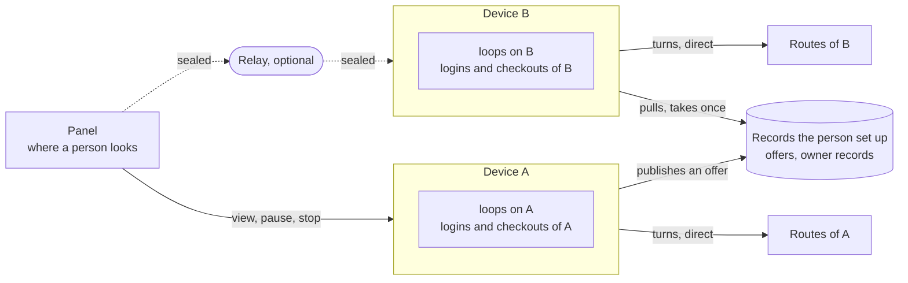

# Loops across devices

Design and research, 2026-11-13. **Nothing on this page is built.** keepgoing today supervises only the loops configured on the machine it runs on: there is no enrollment, no offer, no hop between devices, no relay and no view of another device. Every sentence below that says what keepgoing "does" across devices describes the design, not the program. Where something exists today, the sentence says so.

This page uses the words in the [glossary](glossary.md): loop, lane, route, device, panel. It builds on three things already decided: the two Engineering rules in [AGENTS.md](../AGENTS.md) (keepgoing never extends its own reach; it is never a way around a provider's safeguards), roadmap item [P9](roadmap.md#preferred-routes-planned) (fleet safety before fleet features), and the research in [the command center](command-center.md), which this page refers to instead of repeating.

## The model

There are three different "wheres", and each has its own word. A **device** is a machine running keepgoing; it holds the agents, their logins and the checkouts, and it supervises the loops that live on it. A **route** is where a turn runs: today a model on an account, later also a model served on a machine the person runs, or a cloud session. A **panel** is where a person looks and acts from. A loop belongs to exactly one device at a time and is always shown with that device. A loop can move to another device by a **hop**: the owning device offers it, an enrolled device that may run it takes it, ownership moves exactly once, and the new device starts a new conversation on its own routes with its own logins. An optional **relay** carries sealed status and control messages between a panel and devices that cannot reach each other; it holds no logins, runs no agents and cannot read what it carries.

Nine rules hold the model together. The threat model below names them by number.

1. **One device per loop.** A loop has one owning device at a time and is never shown without it.
2. **Logins never cross.** No credential, token or account session leaves the device it is on, by any path keepgoing provides.
3. **Pull, never push.** A device acts only on what its own configuration allows. Nothing another device, a panel or a relay sends can make it run something its own policy does not already permit.
4. **Ownership moves once.** Each hop advances the loop's owner generation by one; the old owner is fenced before the new one starts.
5. **Bounds carry over and never reset.** Limits already used cross with the loop; a loop that arrives is bounded even if the origin's bounds were missing.
6. **Each device's stop is local.** Anything remote may add a hold. Nothing remote may clear a hold set on the device.
7. **A relay carries and cannot read.** It holds no logins and runs no agents. A request from an agent to its provider goes directly from the device that holds the login, never through a relay.
8. **A refusal or restriction never causes a hop.** It holds for a person, on the device where it happened.
9. **Enrolled by a person, by name, and recorded.** Devices and panels join only by a person's action on the machine itself. Every enrollment, offer, take and revocation is recorded.

## Four questions, answered plainly

**Does a loop have to be on this machine, or could it be on a remote device that we connect to from our device?** It can be on another device. The loop lives where keepgoing, the agent and the login are; what you connect from is a panel. The loop does not run "through" the machine you are looking from, and closing the panel changes nothing on the device.

**What does a hop look like across devices, if it does not all come from the originating device?** The origin's part is small: it stops at the end of a turn, publishes an offer and gives up ownership once. Everything after that is done by the taking device, on its own routes, with its own logins and its own checkout. When the origin cannot be reached, nothing can come from it at all, so by default the loop stays where it is and says so; a loop can be made movable without its origin only by an arrangement set up beforehand ([origin unreachable](#origin-unreachable)).

**Some machines are devices and some are relays; is it like an anonymity network?** There are two roles and they are kept apart: a device runs loops and holds logins, a relay only forwards. The resemblance ends at "a relay forwards what it cannot read". The purpose is the opposite of anonymity: every device is enrolled by name, by a person, and every move is recorded ([contrast](#contrast-an-anonymity-network)).

**If keepgoing were put on a machine with its own GPUs serving models, would that be a loop?** No. The machine is a device. Each model it serves is a route. Each goal an agent works on there is a loop; with no goal there are no loops. keepgoing does not run a model: it supervises the agent that uses one.

## Worked examples

All names are invented.

### A laptop and a virtual machine

A person works on a laptop named `laptop` and has a virtual machine named `build-vm` that stays on. Both run keepgoing, each with its own agent logins and its own checkout of the same repository. The loop `example-app · release prep` runs on `laptop`.

- The panel on `laptop` shows the loop as `example-app · release prep` on `laptop`. If the panel also shows `build-vm`'s loops, each is shown with `build-vm`.
- Before closing the laptop, the person offers the loop. `laptop` finishes the current turn, publishes the offer and holds. `build-vm` sees the offer on its next pull, checks its own policy, takes it, and starts a new conversation from the brief on one of its own routes.
- `laptop`'s logins stay on `laptop`. Work that was pushed to the repository's remote is what `build-vm` continues from; anything not pushed stays in `laptop`'s checkout, untouched.
- If the laptop is closed without offering, the loop stays on `laptop` and pauses with the machine. The panel on `build-vm` shows it as `on laptop, not seen since 14:02`.

### A machine with GPUs serving local models

Two different arrangements use the same hardware, and they are different things.

- **keepgoing runs on it.** Then it is a device, say `gpu-box`. A model it serves is a route on that device, reached by an agent running on `gpu-box`. The route has no plan allowance; its limit is the machine's capacity (how many turns it can serve at once, memory, power), which keepgoing has no notion of today ([local or remote model](command-center.md#local-or-remote-model)). Each goal an agent works on there is a loop on `gpu-box`.
- **It only serves a model to an agent elsewhere.** Then it is not a device. It is the place a route points at: a loop on `laptop` has a route "the local model at an address the person configured". The requests go directly from `laptop` to that address. keepgoing is not installed on the serving machine and knows it only as part of a route.

In both, keepgoing never loads or serves a model. Which agent programs can drive a locally served model was not verified.

### A phone used only as a panel

The phone runs no keepgoing, holds no logins and owns no loops. It is paired as a **panel**: it holds a signing key, and each device holds the list of what that panel may do. By default a paired panel may view status and add a pause or a stop. It may not start, resume, move a loop, change routes, enroll anything or answer an agent's permission prompt unless the person has allowed that panel to, on the device, per action. Interface text on the phone never says "this device"; it names the device each loop is on.

A phone is the thing most likely to be lost. What a finder can do is in the [threat model](#threat-model).

### An edge device that is offline most of the time

A small device named `field-unit` runs keepgoing and an agent, and has a connection for a few minutes a day. It is its own command center ([edge devices](command-center.md#edge-devices-and-local-models)). Its loops are **pinned** (the default): they never leave without the device's own release, so it keeps working through every offline period and nothing else can take its work while it is away. It pulls offers and publishes status when it has a connection. Other devices show its loops as `on field-unit, not seen since …`, which is the truth. A lease ([below](#origin-unreachable)) would be wrong for this device: a device that cannot renew a lease must stop, and this one is expected to be unreachable.

## The hop, step by step

The steps below are the cooperative hop, where the origin is alive. It is the only hop proposed for a first version.

1. **A person offers, or a rule they set beforehand does.** A rule names a specific loop and a condition, for example "offer when no route on this device can take it for an hour". A loop that is stopped, or held for a refusal or restriction, cannot be offered (rule 8).
2. **The origin stops at a turn boundary** and places a hold on the loop ("offered"). It does not cancel a running turn to make an offer.
3. **The origin publishes an offer.** It contains what [crosses](#what-crosses-and-what-never-crosses): the loop's identity and name, the goal and its revision, a reference to the repository (its identity, the branch and the last commit the origin saw on the remote), the brief, the limits already used, the current holds, the owner generation `g`, and an expiry. The origin checks its checkout read-only first and says in the offer how many commits are not pushed and whether the working tree has changes; those do not cross.
4. **Other devices pull.** Each enrolled device reads offers when it next checks. A device may take an offer only if its own policy allows that loop, it already has a checkout of that repository that the person configured, and it has a route that can run. A device can always decline, and declining needs no reason.
5. **One device claims.** The claim names the offer, generation `g` and the claiming device, and is signed by it.
6. **The origin grants once.** The origin is the arbiter. It first records locally that it no longer owns the loop at any generation above `g` (the fence, the same idea as the pending record and target binding in today's [transfer](transfer.md)); only then does it publish a grant naming one claimant as owner at generation `g+1`. It grants at most one claim per offer.
7. **The taker starts only after it has read its own grant.** It then records itself as owner at `g+1`, creates the loop locally with the carried bounds, and starts a new conversation from the brief on its most preferred available route. Unless the offer and the taker's own policy both allow starting without a person, the loop arrives held. A taken loop always has a bound (rule 5).
8. **The origin keeps its history and its checkout.** It never stops, archives or messages the conversation it left, and never touches the repository. If it later sees a record at a generation above its own for that loop, it does nothing with the loop but show where it went.

Hops are counted and spaced per loop, like new conversations today: a cap on hops and a minimum time between them, so a loop cannot bounce between two devices.

### Failure cases

#### Origin unreachable

**Default: the loop stays put and says so.** An origin that cannot be reached cannot stop at a turn boundary, cannot publish a brief and cannot give up ownership. Nothing else has the authority to move its loop, so nothing moves. Other devices and panels show the loop as on its device, with the time it was last seen and the words "may still be running". That is accurate: a device that others cannot reach may be working normally. The person can wait, go to the device, or start a separate loop for the same goal on another device, which is shown as a second loop, not as the first one moved.

**Later, opt-in and per loop: a lease.** A person may mark one loop as movable without its origin. The device then has to keep renewing a short lease on the loop's owner record. Three conditions make that safe enough to consider:

- The owner record lives somewhere that can decide between two writers by an atomic compare-and-swap ([where an offer is published](#where-an-offer-is-published)).
- The origin holds the loop itself, and stops its running turn, as soon as it cannot prove its lease is still valid. It measures that from before its last successful renewal, with a clock that keeps counting while the machine is suspended.
- A taker waits until it has itself watched the record stay unrenewed for the full lease time plus a margin, then takes ownership at `g+1` with a compare-and-swap, and continues from the last checkpoint the origin published at a turn boundary.

**The gap that remains.** A turn that was already running on an origin that froze (a suspended laptop, a paused virtual machine) continues for a moment when the machine wakes, before keepgoing there has checked the record and stopped it. For that moment two agents may be working on the same goal. The provider conversation and the work repository cannot check an owner generation, because keepgoing does not write to either. The two agents are in different conversations and different checkouts, so the collision is limited to what both push to the same remote and any outside effect of the old turn. This gap is why the lease is not the default, and it is listed in the threat model.

#### Both devices alive

This is the normal case and the steps above cover it. If the origin crashes between fencing itself and publishing the grant, the loop has no running owner: the origin, on restart, finds its pending record and either publishes the grant it had decided on or, if it had not chosen a claimant, withdraws the offer and resumes ownership at `g`. It never guesses. If the taker never reads the grant, the loop is owned by a device that has not started it; the record shows that, and the taker starts when it next pulls.

#### The taking device loses its route mid-turn

The taker is the owner. Ordinary rules apply on that device: the turn's failure is classified from structured signals, the loop moves to the next of the taker's own routes if the class allows it, and holds if none can run. The loop does not return to the origin by itself. Sending it back is another offer, counted against the hop cap and spaced. The failed turn's sends are already counted in the carried limits.

#### The offer expires

Nothing was granted, so ownership never moved. The origin withdraws the offer, records that it expired, and returns the loop to the state it was in before the offer: a hold that existed before stays; the "offered" hold is removed. A claim that arrives after expiry is refused.

#### The same offer seen by two devices

Both may claim. The origin grants one. The other reads a grant that names a different device and drops its claim; it has started nothing, because a device starts only after reading its own grant. A device that cannot tell whether its claim was published (a write that timed out) reads the records again; if it cannot read them, it does nothing. An unknown outcome never starts a conversation.

## What crosses and what never crosses

| Crosses, inside the offer | Never crosses |
| --- | --- |
| Loop identity and name | Logins, tokens, API keys, session files, any credential |
| Goal identity, revision and text | Conversation transcripts and agent session state |
| Repository identity, branch, last commit seen on the remote | Files from a checkout, pushed or not |
| The brief: the person's handoff text if configured, otherwise the generated one described in [fallbacks](fallbacks.md#handoff) | The origin's routes, accounts and quota readings |
| Limits already used: sends, the absolute deadline, the no-progress clock, handoff and hop counts | Agent permission and sandbox settings |
| Holds and their notes; the owner generation | The state directory, configuration files, environment, report addresses and their secrets |

Three consequences.

- **Work reaches the new device only through the work repository's own remote**, by pushes the agent made. keepgoing does not copy files and does not commit. An offer says what was not pushed so the person can decide.
- **The new device uses its own settings.** Its routes, its accounts and its agent permission settings are the ones the person configured there. Whether a hop may land on a device whose agent settings are more permissive than the origin's is [undecided](#undecided).
- **The goal and the brief are text written for an agent.** They cross because the work cannot continue without them. They carry no authority: whether a device takes a loop is decided only from structured fields and its own policy, never from that text.

## Where an offer is published

Two devices must both see an offer, with no service hosted by the keepgoing project and without keepgoing ever writing to a work repository.

**Who decides is separate from where it is published.** While the origin is alive it is the arbiter: it grants once, so the place of publication only has to carry signed messages, and may lose, delay or duplicate them without creating two owners. Only a takeover without the origin needs a place that can itself decide between two writers.

The records are the same in every option: small files, each signed by the device that wrote it, with the goal and brief sealed so that only enrolled devices can open them.

| | Direct connection on a local network | A folder the person configures, synced by a tool of theirs | A private records repository the person configures | A relay |
| --- | --- | --- | --- | --- |
| What the person sets up | Each device's address on the other | A folder on each device and a sync tool | An empty private repository, and a narrow credential for it on each device | A small always-on host |
| Both devices must be on at the same moment | Yes | No | No | Yes, unless the relay stores messages |
| Works across networks | No | Depends on the sync tool | Yes | Yes |
| Third party in the path | None | The sync tool's operator, if any | The repository host | Whoever runs the relay |
| What that party sees | Nothing | Sealed files, their sizes and times | Sealed files, sizes, times, which device wrote | Sealed messages, sizes, times, addresses |
| Ordered history | Each device's own log | No; concurrent writes become conflict copies | Yes, one line of commits | No |
| Can decide a takeover without the origin | No | No | Yes: a push that is not a fast-forward is refused | No, unless it becomes a service that orders writes |
| New thing keepgoing must do | Listen on a network port | Write files in one more folder | Commit and push to a repository | Keep an outbound connection |
| Needs a rule reworded | No | No | **Yes** | No |

**The rule in question.** AGENTS.md says keepgoing "never edits, commits to, or merges repositories". A records repository is a new kind of write, and it should not be adopted by stretching the words. It differs from what the rule protects in three ways: the person creates it only for keepgoing's records; it is never a work repository and never an agent's checkout; and keepgoing writes only its own record files there (the list of enrolled devices and panels, owner records, offers, claims, grants, withdrawals, revocations and, for a leased loop, renewals and checkpoints), each as a commit pushed to one branch, never forced. Today's transfer already refuses a configuration or state directory inside a checkout; the records repository would be refused in the same way if it were a work repository or contained anything but records. Adopting it needs the rule reworded to say exactly that, which is a decision for the owner.

**The alternative that needs no rule change.** A plain folder that the person syncs themself. keepgoing only reads and writes files there, as it does in its state directory today. It is enough for the cooperative hop, because the origin decides. Its costs are real: the person must run and trust a sync tool that has its own notion of enrolled machines; concurrent writes produce conflict copies that keepgoing must tolerate; there is no single ordered history to audit; and it can never decide a takeover, so the lease design could not be added on it.

**Recommendation.** Define the records once, independent of what carries them. Build the cooperative hop first on a folder the person configures, which needs no rule change and no network listener. Make the private records repository the intended carrier, adopted only when the owner rewords the rule, because it is the only option that gives an ordered history of every move without a hosted service and the only one on which a takeover without the origin could later be decided. A direct connection is a later convenience for two machines on one network. A relay is not needed for hops at all.

One limit of the recommendation: a repository host that showed different histories to different devices could let two takers both believe they won a takeover. In the cooperative hop this cannot produce two owners, because the origin grants once. For a leased loop the host's honesty about ordering is assumed.

## Enrollment and revocation

**Enrolling a device.** A person runs an enroll command on the new machine. It creates a key pair there; the private key never leaves. The machine shows its name and a short code. On a device that is already enrolled, the person confirms the name and code. The new device is then added to the signed list of enrolled devices, and that addition is reported on every device's panel. The first device starts the list. keepgoing never enrolls a machine from somewhere else, never installs or starts itself on one, and never finds machines by itself.

**Enrolled is not permitted.** A newly enrolled device may take nothing. On each device, the person says which loops or repositories that device may take, and whether a taken loop may start without them. That allowance is stored on the device that would do the work, so no other device can widen it (rule 3).

**Pairing a panel.** The same exchange, with the role "panel". Its key can sign requests; it cannot open sealed goal text unless the person allowed that. What a panel may do is stored on each device, not on the panel.

**Revoking.** A person removes a device or panel from the list, on any device they are at. From then on other devices refuse its claims, offers and control requests, and stop sealing records to it. Revocation is of the machine's own key, not of the code used to enroll it, so it does remove the machine; the [fleet research](command-center.md#fleets-of-devices) found that revoking an enrollment secret usually does not. What revocation cannot do:

- It cannot reach into the revoked machine. Loops it owns stay with it and are shown as "on a revoked device". An honest device that reads its own revocation holds all its loops; a stolen one may not.
- It cannot remove the agent logins on that machine. Only the person can do that, with each provider.
- It cannot take back goal text and briefs the machine could already open.

## The relay

A relay exists for live things: a panel's view of a device it cannot reach directly, and a pause or stop that should arrive promptly. Hops do not need it. Running one is optional, and the person runs it; the [options for remote reach](command-center.md#options-for-the-dock-least-infrastructure-first) put a user's own private network ahead of any relay.

| A relay can | A relay cannot |
| --- | --- |
| See which enrolled keys talk to which, when, and how much | Read status, goal text, briefs or control requests |
| See the network addresses of both ends | Forge or alter a message without it being rejected |
| Drop, delay, reorder or repeat messages | Make a repeated message count: each is bound to a loop, an owner generation and an expiry |
| Go offline | Hold a login, run an agent, own a loop or be offered one |
| | Carry a request from an agent to its provider |

Because a relay can delay or drop, a remote stop is shown as "sent, not confirmed" until the device acknowledges it, and each device's own stop and bounds do not depend on any relay (rule 6). A relay on the same machine as a device gives little separation: whoever takes the machine has both. Unlike an anonymity network there is one relay, chosen and named by the person, and it sees both ends.

## Lanes on other devices

After lanes are first-class members of a loop (roadmap P6), a lane could be offered and taken exactly as a loop is: pulled by an enrolled device whose own policy allows it, with its own device shown beside it, on that device's routes and logins. The loop itself stays on its device and remains the owner of the goal. The lane receives a share of the loop's bounds with the offer, fixed at that moment, so a lane on a device that later cannot be reached can never use more than its share. Its results return through the work repository's remote, not through keepgoing. None of this should be designed in detail before P6 and the cooperative hop both exist.

## Threat model

"Rule" refers to the nine rules above; "reach" and "safeguards" are the two Engineering rules in AGENTS.md.

| Threat | What it can do | What it cannot do | What stops it |
| --- | --- | --- | --- |
| **A lost or stolen phone paired as a panel** | View loop status. Add pauses and stops, which waste time but spend nothing. | Start, resume, move, change routes, enroll, answer permission prompts, read goal text, or reach any login, unless the person had allowed that panel to. | Panel defaults; allowances stored on devices; revocation; rule 6 means its holds are cleared by the person on the device. |
| **A stolen device** | Use the agent logins on it (outside keepgoing's control). Open goals and briefs sealed to it. Publish offers and claim loops its policy on other devices permits, until revoked. Keep running its own loops. | Obtain another device's logins. Make another device run anything that device's own policy does not allow. Clear another device's holds. | Rules 2, 3, 6; revocation. The logins on it must be revoked with each provider by the person. |
| **A malicious or compromised relay** | Observe who talks to whom and when. Drop or delay messages, including a remote stop. | Read or forge messages, replay one usefully, obtain a login, see provider traffic. | Rule 7; sealing and signatures; acknowledgement of remote controls; local stop and bounds. |
| **A compromised enrolled device** | Everything a stolen device can. Publish an offer whose goal or brief text is hostile, which a device with a matching allowance would hand to its agent. Lie about limits used. Ignore its own fence and keep working. | Widen what other devices accept. Lower the bounds a taker enforces. Move a loop it does not own. | Rule 3 (allowances name specific loops and live on the taker); rule 5 (a taker enforces the stricter of the carried and its own bounds, and never accepts used counts lower than the last recorded); a changed goal revision arrives held; rule 4. Not fully stopped: see below. |
| **A frozen origin with a turn still running** (leased loops only) | Continue that turn briefly after waking, while a taker is already working. | Start another turn: the origin holds once it checks the record. | Rule 4 and the origin's self-hold. Not fully stopped; this is why the lease is opt-in, per loop and not in a first version. |
| **An agent instructed by hostile content to spread** | Whatever its own permissions on its device allow, as today. If it can run commands as the person, it can run keepgoing's commands. | Cause keepgoing to install or start itself anywhere, copy a login, or enroll a machine with one device's action alone. Make another device accept a loop outside its allowance. | Reach; rules 2, 3 and 9; enrollment needs a person at two machines and is reported on every panel. keepgoing never acts on transcript text, so nothing the agent reads or writes is an instruction to keepgoing. |
| **An agent instructed to evade a limit** | Finish turns that change nothing; ask to be moved. | Regain spent allowance by hopping: used counts cross and cannot decrease. Hop without bound: hops are capped and spaced. Turn a refusal into a move. | Rules 5 and 8; the hop cap. |
| **A person using it to get around a provider restriction** | Run their own work on any machine and account they are entitled to use, as they could without keepgoing. | Have keepgoing move a loop because of a refusal, a policy block or an account restriction. Use a relay or another device to carry requests so that they appear to come from elsewhere. Gain allowance by adding devices: an allowance belongs to an account, and the same account on two devices is one allowance. Share a login between machines through keepgoing. | Safeguards; rules 2, 7 and 8. |

Two limits on these claims should be read with the table.

- **keepgoing's protections are cooperative on one machine.** An agent, or anyone, who can edit keepgoing's files or run its commands as the person has the person's authority on that device; [transfer](transfer.md) says the same about today's ownership. The checks that matter against a compromised device are therefore the ones made on the *other* devices.
- **Rule 8 depends on a signal that does not exist yet.** No adapter reports a refusal or restriction as its own structured state today (roadmap P8). Until one does, such a turn looks idle or unknown, and keepgoing cannot refuse to offer the loop on that ground.

## How existing systems solve the same problems

Read 2026-11-13. Dates and versions are those the source shows. The [fleet table](command-center.md#fleets-of-devices) in the command-center page already covers self-hosted runner registration, GitLab and Buildkite polling, Kubernetes node bootstrap, device job rejection and mesh-network device approval; it is not repeated here.

### Enrolling a machine by a person

- **File sync.** A Syncthing device ID is derived from the device's own certificate: "the SHA-256 hash of the certificate data in DER form", and a connection from an ID that is not expected is dropped; adding a device "needs to be done twice, once for each side" ([device IDs](https://docs.syncthing.net/dev/device-ids.html), v2.1.0). This is the pattern proposed here: a key made on the machine, and agreement on both sides.
- **A counter-example.** Syncthing's introducer "lets a device automatically add new devices" ([introducer](https://docs.syncthing.net/users/introducer.html), v2.1.0). It is convenient and it is what rule 9 excludes: a device that can add devices for others.
- **Mesh network.** Tailnet Lock means no machine joins "unless trusted nodes in your tailnet sign the new node", so "you don't need to trust the Tailscale coordination server for distributing public node keys"; it starts from trust on first use ([Tailnet Lock](https://tailscale.com/kb/1226/tailnet-lock), validated 2025-12-02). This supports a device list signed by enrolled devices and not by whatever stores it.
- **Build agents.** Registering an Azure Pipelines agent needs a person in the pool's administrator role, and that role "is needed only at the time of registration and isn't persisted on the agent" ([agents](https://learn.microsoft.com/en-us/azure/devops/pipelines/agents/agents), 2026-08-18). GitHub removes a self-hosted runner that "has not connected to GitHub Actions for more than 14 days" ([removing runners](https://docs.github.com/en/actions/how-tos/manage-runners/self-hosted-runners/remove-runners)); whether enrolled devices here should lapse is [undecided](#undecided).
- **A narrow credential for one repository.** A deploy key is "an SSH key that grants access to a single repository", read-only unless write access is given ([deploy keys](https://docs.github.com/en/authentication/connecting-to-github-with-ssh/managing-deploy-keys)). It is the kind of credential a records repository would need on each device, set up by the person.

This supports enrolling each machine by name, by a person, with a key made on the machine. Nothing found argues against it; the introducer shows the shortcut to avoid.

### Pulled work and pushed work

- **Build agents.** Azure Pipelines: "The agent always initiates this communication", by "an HTTP long poll", and "This pull model allows you to configure the agent to different topologies" ([agents](https://learn.microsoft.com/en-us/azure/devops/pipelines/agents/agents)). GitHub: runners "connect to GitHub to receive job assignments" and need only "outbound HTTPS connections over port 443" ([self-hosted runners](https://docs.github.com/en/actions/reference/runners/self-hosted-runners)). Jenkins describes an agent as something that "connects to a Jenkins controller and is assumed to be unreliable", and advises that builds "should be executed on other nodes than the built-in node" because what a build does is "often controlled by people less trusted than a Jenkins administrator" ([nodes](https://www.jenkins.io/doc/book/managing/nodes/), [controller isolation](https://www.jenkins.io/doc/book/security/controller-isolation/)).
- **Volunteer computing.** The BOINC app "downloads scientific computing jobs and runs them" on the volunteer's computer ([BOINC](https://boinc.berkeley.edu/)); its client decides which project to "ask … for work" ([client scheduling](https://github.com/BOINC/boinc/wiki/ClientSched), edited 2023-04-02), and the project treats clients as "Untrusted: they may return incorrect computational results" ([overview](https://github.com/BOINC/boinc/wiki/BOINC-Overview), edited 2026-03-06).

This supports a pulled hop: fetching work over an outbound connection is the common design, and it lets a machine sit behind any network. One difference matters. In all of these the worker pulls from a central queue and runs what the queue assigns; pulling alone does not give the worker a say. What makes a keepgoing device able to refuse is that the allowance lives on the device (rule 3), which these systems have only in weak forms such as labels and tags. Pull is therefore necessary and not sufficient.

### Relays that cannot read what they forward

- **File sync.** With a Syncthing relay, "The connection between two devices is still end to end encrypted, the relay only retransmits the encrypted data much like a router"; "the relay knows your IP and device ID" and its operator "can see the amount of traffic flowing between devices" ([relaying](https://docs.syncthing.net/users/relaying.html), v2.1.0). The page has a section on running your own.
- **Mesh network.** "A DERP server blindly forwards already-encrypted traffic", and because private keys never leave the device "it's impossible for a DERP server to decrypt your traffic" ([DERP servers](https://tailscale.com/kb/1232/derp-servers), validated 2026-01-21).
- **File transfer by code.** Magic Wormhole pairs two machines with a short code and a password-authenticated key exchange; its mailbox server is "a simple WebSocket-based relay that delivers messages from one client to another", its transit relay carries messages "which are all encrypted", and a malicious mailbox server gets "only a single guess" at subverting a connection ([Magic Wormhole](https://magic-wormhole.readthedocs.io/en/latest/welcome.html)). This is evidence that a short code shown on one machine and confirmed on another can enroll a key through an untrusted carrier.
- **Sealed storage on a machine that is not trusted.** Syncthing's untrusted devices hide file data, names and structure but not "File sizes" or the folder's ID and label; the feature is marked beta ([untrusted devices](https://docs.syncthing.net/users/untrusted.html)). `age` encrypts one file to several public keys: "Every recipient will be able to decrypt the file" ([age](https://github.com/FiloSottile/age)). Sealing records to the list of enrolled devices is ordinary; sizes and times still leak.
- **Remote-session relays.** The vendor relays described in [the command center](command-center.md#how-others-do-it) differ on exactly this point. Claude Code Remote Control makes "outbound HTTPS requests only and never opens inbound ports", but "All traffic travels through the Anthropic API over TLS" and the transcript "is stored on Anthropic servers" while connected: that relay can read ([Remote Control](https://code.claude.com/docs/en/remote-control)). Codex names "A secure relay layer" without saying who can read it ([remote connections](https://learn.chatgpt.com/docs/remote-connections)). Happy's README says "what moves between your devices is encrypted" and lists a relay server "for encrypted sync" ([Happy](https://github.com/slopus/happy)).

This supports a relay kept separate from devices: forwarding without reading is established practice, and every source is candid that the relay still learns addresses, identities and volume. The table in [the relay](#the-relay) says the same.

### One owner, without split brain

- **A lease alone is not safe.** "if the GC pause lasts longer than the lease expiry period, and the client doesn't realise that it has expired, it may go ahead and make some unsafe change". The remedy is a fencing token, "a number that increases … every time a client acquires the lock", and it "requires the storage server to take an active role in checking tokens" ([Kleppmann](https://martin.kleppmann.com/2016/02/08/how-to-do-distributed-locking.html), 2016-02-08). keepgoing's owner generation is such a number. The honest finding is the last clause: the things a loop writes to (a provider conversation, a work repository) do not check it, which is the gap stated under [origin unreachable](#origin-unreachable).
- **Clusters do not assume silence means stopped.** "If the cluster just assumed that uncommunicative nodes were down, then multiple instances of a resource could be started on different nodes"; fencing is "the ability to make a node unable to run resources, even when that node is unresponsive" ([Pacemaker](https://clusterlabs.org/projects/pacemaker/doc/3.0/Pacemaker_Explained/html/fencing.html), 3.0). keepgoing has no way to make another machine unable to run, so its default must be the other safe choice: do not move.
- **Compare-and-swap without a service of one's own.** Git "refuses to update a remote ref that is not an ancestor of the local ref used to overwrite it" ([git-push](https://git-scm.com/docs/git-push), 2.55.0). Object storage offers the same: with a conditional write, "the first write operation to finish succeeds" and later ones fail ([S3 conditional writes](https://docs.aws.amazon.com/AmazonS3/latest/userguide/conditional-writes.html)). A synced folder does not: on conflicting changes one file "will be renamed to `<filename>.sync-conflict-<date>-<time>-<modifiedBy>.<ext>`" and both copies spread ([Syncthing syncing](https://docs.syncthing.net/users/syncing.html)).
- **Leases in cluster software.** Kubernetes uses Lease objects for node heartbeats and for electing a single active instance of a component ([Leases](https://kubernetes.io/docs/concepts/architecture/leases/)); etcd deletes the keys attached to a lease when it expires and offers transactions for compare-and-swap ([etcd API](https://etcd.io/docs/v3.6/learning/api/)). Both are stated here in paraphrase.

This argues against a single hop mechanism for every case: one mechanism does not cover both the living and the unreachable origin. With a living origin, a grant by the origin is enough. Without it, a lease needs a deciding store, and even then the resource-side check that makes a lease safe is missing.

### Contrast: an anonymity network

Tor is "designed to anonymize" traffic: a client downloads "a signed directory of the relays on the network", "chooses a path—a sequence of relays", and each relay "knows its precessor and successor, but no other relays in the circuit" ([Tor specifications](https://spec.torproject.org/intro/), spelling as in the source). The design here shares one property, a relay that forwards what it cannot read, and reverses the rest: no directory of machines to discover, no chain of relays, no machine that is unknown to the person, and a record of every move.

### Could not verify

- The lease paper by Gray and Cheriton (1989) and the "sequencer" passage of the Chubby paper (2006) could not be opened; they are cited by Kleppmann's article and not quoted here.
- The Kubernetes and etcd statements were read through a summarising fetch and are paraphrased, not quoted.
- Tor's use of three relays and of volunteer operators: the project's support pages did not load; only the specification introduction was read.
- BOINC: how a volunteer attaches a computer to a project, how results are validated, and a statement that the server never contacts the client.
- Whether Happy's relay can be self-hosted and sees only ciphertext: the README read here does not say so in those words.
- Whether a Syncthing or Magic Wormhole relay is operated by volunteers; whether Magic Wormhole's servers see network addresses.
- Jenkins: a sentence stating the direction of an inbound agent's connection in those words.
- Whether any hosted git service documents that a ref update is linearizable across its replicas. The design assumes it for a leased loop only.
- Short quotations were taken through a fetch that may return parts of longer sentences.

## Where the design is weakest

1. **Nothing the loop writes to checks who owns it.** The owner generation fences keepgoing, not the agent, the provider conversation or the work repository. With a living, honest origin that is enough. With a frozen origin under a lease, or a compromised one that ignores its fence, two agents can work on one goal for a time, and only the repository's own push rules stand between them.
2. **Enrolled devices trust each other with the text of work.** A compromised device can publish an offer whose goal or brief is hostile, and a device with a standing allowance for that loop will give it to an agent running with its own logins. Allowances per loop, a hold on a changed goal revision, carried bounds and the agent's own safeguards narrow this; they do not close it. Enrolling a machine means trusting it to write prompts for agents on the others.
3. **Everything on one device rests on cooperation.** An agent that can run commands as the person can run keepgoing's commands, including offering a loop or starting an enrollment. keepgoing can require a second machine and make the event visible, but it cannot tell the person from a process running as the person without something outside itself, such as a confirmation the operating system guards.

Also weak, and already noted: rule 8 has no structured signal behind it yet; the recommended carrier needs a rule reworded; and work that was not pushed does not cross.

## Undecided

- Whether keepgoing may commit and push to a private records repository, which needs the rule in AGENTS.md reworded, or stays with a folder the person syncs.
- Whether the lease design should exist at all, given its remaining gap, and if so its times and margins.
- Whether enrolling or approving on a device should require a confirmation guarded by the operating system, so that a process running as the person cannot complete it.
- Whether a hop may land on a device whose agent permission settings are more permissive than the origin's, or must be refused or approved each time.
- Whether a device keeps a checkout ready by the person's own setup only (assumed here) or keepgoing may ever ask an agent to create one.
- Whether a rule may offer a loop at all in a first version, or only a person may.
- Whether enrolled devices lapse after not being seen, and whether a revoked device's loops may be taken by another after a waiting time.
- Devices that belong to more than one person. Everything here assumes one person, or one organisation's accounts; a loop taken by another person's device would run on that person's account.
- How records are sealed and signed (formats and key types), and how the list of enrolled devices is protected against being rolled back.
- The word for an enrolled panel that is not a device, and the words for a pinned and a leased loop in interface text.
- Capacity as the bound on a local-model route: keepgoing has no notion of it yet.
